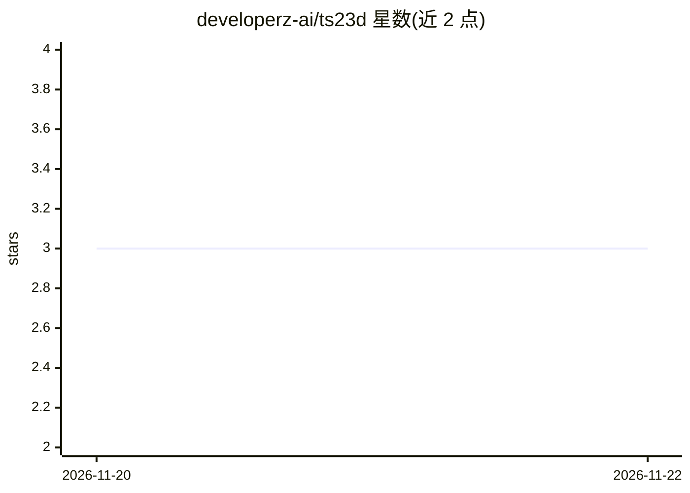

# developerz-ai/ts23d

⭐ 3 · TypeScript · MIT · 推送 2026-11-21 · [GitHub](https://github.com/developerz-ai/ts23d) · [官网](https://developerz-ai.github.io/ts23d/) · 组织维护

**给编码 agent 的免费 3D 资产生成器：TS DSL 编译为游戏可用 glTF**

提供一套 TypeScript DSL，`t3d build` 将其确定性编译为 GLB，输出可在 Unity/Unreal/Godot/three.js/Babylon 读取。特性包括命名可动部件、socket/emitter 导出、单源 3 级 LOD、trim-sheet 材质、draw call 预算、QA 门（出问题时 exit 1 并给 T3D_QA_* 代码）、规格书尺寸校验（±5%/±2%）、CPU 渲染的 contact sheet 与 hero 图供视觉 agent 自检。默认路径无需 GPU、无积分、无服务；可选 adapter 接入本地 GPU 模型、Blender 步骤与 Meshy 等图像/网格服务。通过 npm 分发，CLI 由 Bun 运行，库在 Node ≥22 下导入。

## 筛选速览

| 维度 | 判定 | 备注 |
|---|---|---|
| AI 角色 | `ai-ecosystem` | LLM/agent 周边工具 |
| 许可风险 | `permissive` | MIT |
| 部署形态 | `None` |  |
| 模型依赖 | — | README 未给出锁定关系 |
| 硬件要求 | — | 无带数字的原话,不猜 |
| 安装摩擦 | `low` | 无编译、无系统依赖或容器化 |
| 成熟度 | — | 结构信号不足 |

## 能力要点

- TypeScript DSL 确定性编译为游戏可用 GLB，含 3 级 LOD 与 draw call 预算
- QA 门与代码级检查（接触、重叠、预算、规格尺寸容差），失败给出 T3D_QA_* 代码
- CPU 渲染 contact sheet 与 AI review pack，供视觉 agent 查看并修复问题
- 可选 NeuralAdapter 接入本地 GPU 模型或 Meshy，经 headless Blender 完成重拓扑/烘焙/蒙皮

## 适用场景

- 让 Claude Code 等 agent 为游戏项目批量生成车辆、建筑、道具等 glTF 资产
- 在无 GPU 的 CI 中复现资产构建与 QA 校验
- 用 family/variant 参数从一套代码派生多款同类资产
- 以 spec-sheet 声明把模型尺寸钉在真实规格上

## 场景标签

`代码生成` · 领域:编码与开发

## 证据(README 行号)

> L3: **Free 3D asset generator for coding agents. Your agent writes TypeScript; ts23d compiles it to game-ready glTF — fo
> L65: **Use the LLM you already pay for to write the assets your project needs (vehicles, buildings, props, whole streets
> L67: Each asset is a TypeScript module. `t3d build` compiles it, deterministically, to GLB. Free: no GPU, no credits, no

## 星数曲线

2026-11-20 3 → 2026-11-22 3（+0）

---
*卡片 v1 · prompt 1.4 · 生成 2026-11-22 · 置信度 high · 依据 README sha `455cc31b1d49` · [字段定义](../../DATASET.md)*
