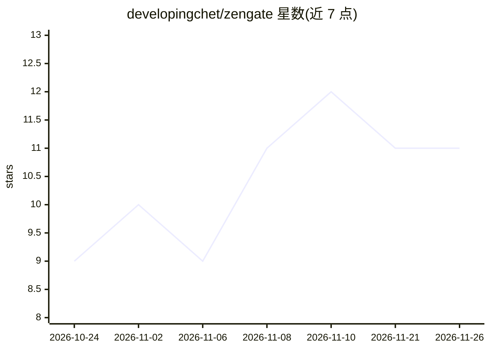

# developingchet/zengate

⭐ 11 · JavaScript · MIT · 推送 2026-11-23 · [GitHub](https://github.com/developingchet/zengate) · 个人维护

**自托管 OpenAI 兼容网关：免密访问 OpenCode Zen 免费模型**

以 Node.js/Docker 运行的本地 API 网关：后台运行真实 OpenCode CLI（opencode serve，npm 依赖自动安装），把 OpenAI API 请求翻译为短生命周期 OpenCode 会话，面向任何 OpenAI SDK/工具提供 Chat Completions、Responses API、流式、function calling（提示注入模拟）、JSON 输出及图像/音频/视频/PDF 输入。默认开启网关密钥认证；采样参数被忽略，max_tokens 为近似截断。仅限个人或团队使用，不可转售。

## 筛选速览

| 维度 | 判定 | 备注 |
|---|---|---|
| AI 角色 | `ai-ecosystem` | LLM/agent 周边工具 |
| 许可风险 | `permissive` | MIT |
| 部署形态 | `self-host` | docker 或自建部署 |
| 模型依赖 | — | README 未给出锁定关系 |
| 硬件要求 | — | 无带数字的原话,不猜 |
| 安装摩擦 | `low` | 无编译、无系统依赖或容器化 |
| 成熟度 | — | 结构信号不足 |

## 能力要点

- OpenAI 兼容 API：Chat Completions、Responses、legacy completions 与模型列表端点
- keyless 机制：上游免密，网关自身用随机生成密钥认证
- 输入支持文本、图像、音频、视频与 PDF（compatible 配置文件）
- 默认配置隔离：临时目录与仅监听 127.0.0.1 的后端，拒绝宿主工具

## 适用场景

- 让任意 OpenAI SDK 客户端接入 OpenCode Zen 免费模型
- 团队内自托管统一 API 网关并按密钥分发使用
- 用 Open WebUI、Aider 等工具调用免费模型的 Chat/Responses 接口

## 场景标签

`模型网关` · 领域:Agent 开发

## 证据(README 行号)

> L12: An **OpenAI-compatible API for OpenCode's free Zen models: no Zen account or upstream API key needed.**
> L26: OpenCode's free Zen models only work from inside OpenCode. So this gateway does not imitate OpenCode. It **runs the
> L147: Anything that accepts an OpenAI base URL and API key works: the official SDKs, LangChain, LlamaIndex, Open WebUI, 

## 星数曲线

2026-10-24 9 → 2026-11-26 11（+2）

---
*卡片 v1 · prompt 1.4 · 生成 2026-11-18 · 置信度 high · 依据 README sha `46253c6c4ff5` · [字段定义](../../DATASET.md)*
