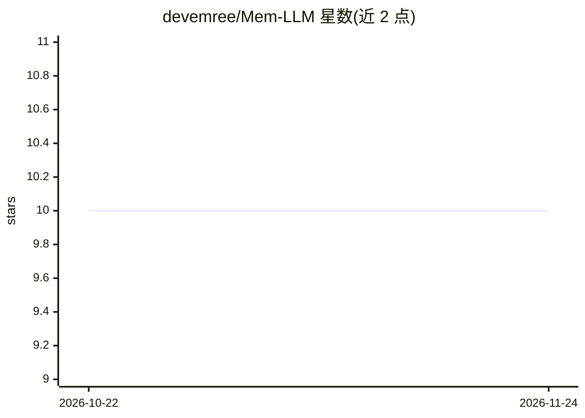

# devemree/Mem-LLM

⭐ 10 · Python · Apache-2.0 · 推送 2026-09-04 · [GitHub](https://github.com/devemree/Mem-LLM) · [官网](https://emredeveloper.vercel.app/) · 个人维护

**基于本地 LLM 构建带记忆的多用户 AI 助手的 Python 框架**

Mem-LLM 是一个隐私优先的 Python 框架，用于在本地 LLM 上构建带持久记忆的 AI 助手：按用户维护 JSON 或 SQLite 的对话历史，提供 MemoryRouter 管理核心记忆、档案记忆、召回、图谱上下文与知识库检索，支持时间性图谱记忆、工具调用（@tool）、流式输出、对话分析与 REST API/Web UI。面向需要本地化、数据不出本机的助手开发场景；v2.5 起补充了 OpenAI 兼容接口与 llama.cpp 后端。

## 筛选速览

| 维度 | 判定 | 备注 |
|---|---|---|
| AI 角色 | `ai-ecosystem` | LLM/agent 周边工具 |
| 许可风险 | `permissive` | Apache-2.0 |
| 部署形态 | `desktop` | 安装包/桌面程序 |
| 模型依赖 | local-ok | 支持本地模型 |
| 硬件要求 | — | 无带数字的原话,不猜 |
| 安装摩擦 | `low` | 无编译、无系统依赖或容器化 |
| 成熟度 | — | 结构信号不足 |

## 能力要点

- 每用户持久记忆（JSON 或 SQLite）与多用户支持
- MemoryRouter 统一核心记忆、档案记忆、召回与图谱上下文
- 时间性图谱记忆，支持当前与历史图谱查询
- 多后端：Ollama、LM Studio、OpenAI 兼容 API、llama.cpp

## 适用场景

- 在本机离线运行一个记得用户信息的对话助手
- 为多名用户分别保存对话历史与记忆
- 把知识库接入本地 LLM 助手并暴露 REST API

## 场景标签

`Agent 记忆` · 领域:Agent 开发

## 证据(README 行号)

> L7: Mem-LLM is a privacy-first Python framework for building memory-enabled AI assistants that run locally.
> L70: - Multi-backend support (Ollama, LM Studio, OpenAI-compatible APIs, llama.cpp)

## 星数曲线

2026-10-22 10 → 2026-11-24 10（+0）

---
*卡片 v1 · prompt 1.4 · 生成 2026-11-19 · 置信度 high · 依据 README sha `9c8d05b470c7` · [字段定义](../../DATASET.md)*
