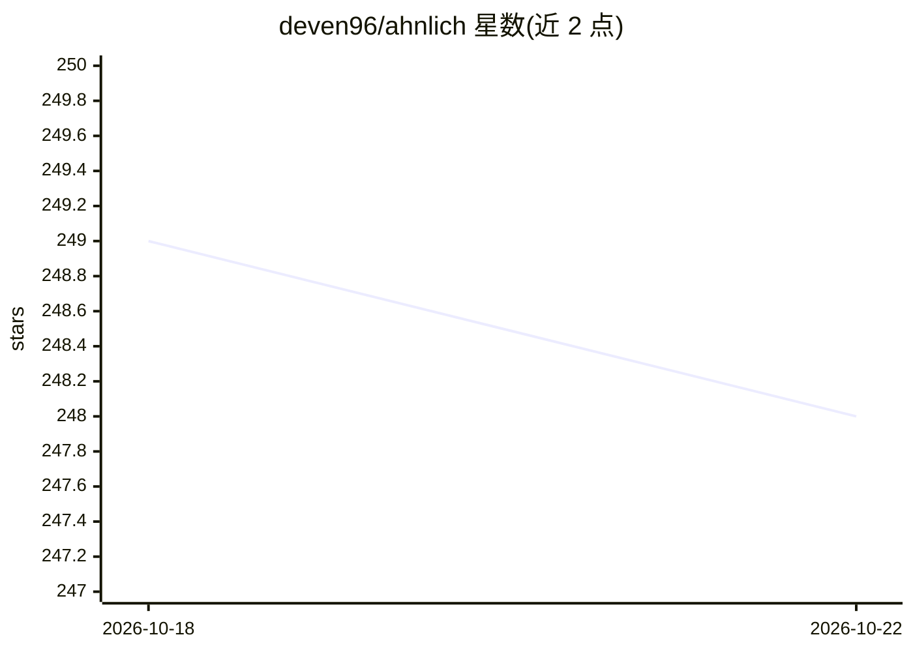

# deven96/ahnlich

⭐ 248 · Rust · MIT · 推送 2026-10-20 · [GitHub](https://github.com/deven96/ahnlich) · [官网](http://ahnlich.dev/) · 个人维护

**内存向量数据库与 AI 代理工具套件，供 AI/ML 工程师存取检索嵌入**

包含多个工具：ahnlich-db 是内存键值向量存储，支持线性（cosine/euclidean）与非线性（HNSW）相似度搜索及元数据过滤；ahnlich-ai 是代理服务，接收原始文本/图像输入，经模型转为嵌入后存入 DB，供开发者以原始输入查询；另有 Rust/Python/Go/Node.js 四种客户端与 CLI。提供多平台二进制、Docker 镜像与 docker-compose 示例（含持久化、健康检查）。执行提供者支持 CUDA（≥v12）、Apple CoreML、AMD MIGraphX，不支持的硬件回退 CPU。README 声明项目演进较快，可能偶有破坏性更新。

## 筛选速览

| 维度 | 判定 | 备注 |
|---|---|---|
| AI 角色 | `ai-ecosystem` | LLM/agent 周边工具 |
| 许可风险 | `permissive` | MIT |
| 部署形态 | `self-host` | docker 或自建部署 |
| 模型依赖 | — | README 未给出锁定关系 |
| 硬件要求 | — | 无带数字的原话,不猜 |
| 安装摩擦 | `low` | 无编译、无系统依赖或容器化 |
| 成熟度 | `idea` | |

## 能力要点

- 线性（cosine/euclidean）与非线性（HNSW）相似度搜索及元数据过滤
- ahnlich-ai 代理将原始文本/图像转为嵌入存取，可选多种现成模型
- Rust/Python/Go/Node.js 客户端与 CLI
- DB 可脱离 AI 代理单独使用

## 适用场景

- 为 AI/ML 应用存储与检索向量嵌入
- 用原始文本或图像直接查询相似条目
- 通过 docker-compose 部署带持久化与健康检查的向量库

## 场景标签

`向量数据库` · 领域:知识与检索

## 证据(README 行号)

> L11: - `ahnlich-db`: In-memory vector key value store for storing embeddings/vectors with corresponding metadata(key-val
> L18: - `ahnlich-ai`: AI proxy to communicate with `ahnlich-db`, receiving raw input, transforming into embeddings, and s

## 星数曲线

2026-10-18 249 → 2026-10-22 248（-1）

---
*卡片 v1 · prompt 1.4 · 生成 2026-10-22 · 置信度 high · 依据 README sha `4e50cb021730` · [字段定义](../../DATASET.md)*
