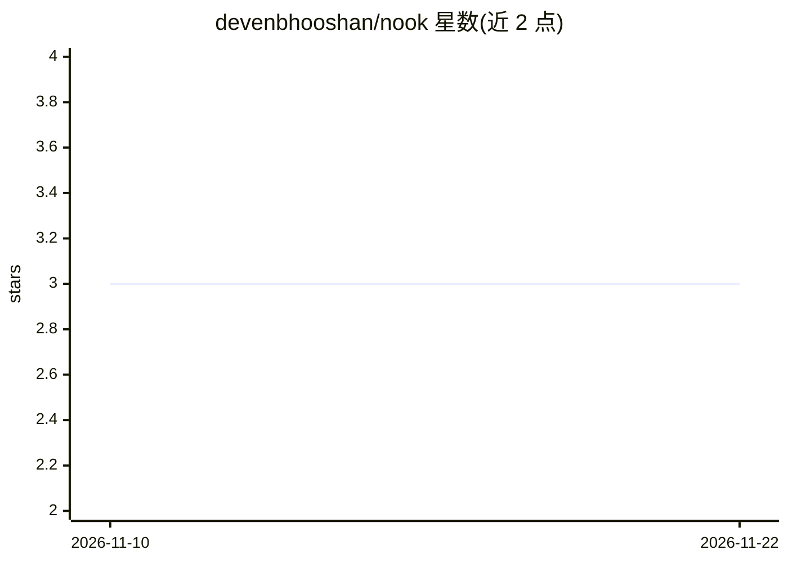

# devenbhooshan/nook

⭐ 3 · Swift · MIT · 推送 2026-11-20 · [GitHub](https://github.com/devenbhooshan/nook) · 个人维护

**本地优先的 macOS 邮件客户端，支持本机模型打标**

面向 macOS 的本地优先邮件客户端：邮件同步到本机 SQLite（SQLCipher AES-256 加密），搜索、过滤、标签均在本地运行，无厂商服务器，直接以用户自建的 Google OAuth 客户端连接 Gmail。AI 部分包括：用 Apple Intelligence 或本地 Ollama 模型对新邮件打自定义标签、内置本地 MCP 服务器（nook-mcp）供 Claude Code/Claude Desktop 等读取邮件并打开草稿（不能发送）。另提供键盘快捷键、⌘K 命令面板、提醒、日历视图与 Gmail 风格搜索操作符。

## 筛选速览

| 维度 | 判定 | 备注 |
|---|---|---|
| AI 角色 | `ai-enhanced` | 去掉 AI 部分产品仍成立 |
| 许可风险 | `permissive` | MIT |
| 部署形态 | `desktop` | 安装包/桌面程序 |
| 模型依赖 | local-ok | 支持本地模型 |
| 硬件要求 | — | 无带数字的原话,不猜 |
| 安装摩擦 | `low` | 无编译、无系统依赖或容器化 |
| 成熟度 | — | 结构信号不足 |

## 能力要点

- 新邮件由本机模型（Ollama/Apple Intelligence）按自定义标签描述打标
- 内置本地 MCP 服务器 nook-mcp，供 AI 助手搜索读取邮件并打开草稿
- 本地 SQLite 存储，SQLCipher AES-256 加密，支持离线搜索
- 单键快捷键、⌘K 命令面板与拆分收件箱

## 适用场景

- 在 Mac 本地管理 Gmail 邮件并自动分类打标
- 让 Claude 通过 MCP 查询邮件并起草回复供人工审核
- 阻止远程跟踪像素、保障邮件隐私的日常收发

## 场景标签

 · 领域:效率工具/邮件客户端

## 证据(README 行号)

> L5:  A private, local-first email client for macOS.
> L13: - **On-device AI tagging.** New mail is tagged with labels you define, such as *Needs Reply*, *Receipt* or *Newslet

## 星数曲线

2026-11-10 3 → 2026-11-22 3（+0）

---
*卡片 v1 · prompt 1.4 · 生成 2026-11-22 · 置信度 high · 依据 README sha `f7d905e9c7e6` · [字段定义](../../DATASET.md)*
