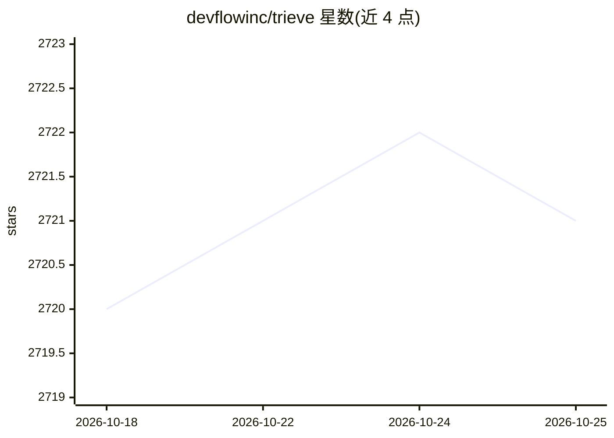

# devflowinc/trieve

⭐ 2,721 · Rust · MIT · 推送 2026-01-25 · [GitHub](https://github.com/devflowinc/trieve) · [官网](https://trieve.ai) · 组织维护

**面向开发者的搜索/推荐/RAG 一体化基础设施 API 平台**

Trieve 提供通过 API 交付的搜索、推荐、RAG 与分析一体化平台，服务端用 Rust (actix/actix-web/diesel) 编写。支持自托管于 VPC 或本地（AWS/GCP/Kubernetes/docker compose 指南），集成 OpenAI/Jina 嵌入与 Qdrant 做稠密向量检索，用 SPLADE 稀疏向量实现容错全文检索，支持混合检索加交叉编码器重排、分组、过滤、新鲜度偏置等。RAG 路由经 OpenRouter 接入多种 LLM，也可自带嵌入/重排/LLM 模型。本地开发需安装 Rust、Node/Yarn 等依赖并编译运行多个服务。

## 筛选速览

| 维度 | 判定 | 备注 |
|---|---|---|
| AI 角色 | `ai-ecosystem` | LLM/agent 周边工具 |
| 许可风险 | `permissive` | MIT |
| 部署形态 | `self-host` | docker 或自建部署 |
| 模型依赖 | locked-api |  |
| 硬件要求 | — | 无带数字的原话,不猜 |
| 安装摩擦 | `low` | 无编译、无系统依赖或容器化 |
| 成熟度 | — | 结构信号不足 |

## 能力要点

- 语义稠密向量检索（OpenAI/Jina 嵌入 + Qdrant）与 SPLADE 稀疏向量容错全文检索
- RAG API 路由经 OpenRouter 接入多种 LLM，支持自带模型（嵌入/SPLADE/重排/LLM）
- 混合检索 + BAAI/bge-reranker-large 交叉编码器重排
- 支持 VPC/本地自托管（AWS/GCP/Kubernetes/docker compose）

## 适用场景

- 为产品添加语义搜索与容错全文检索 API
- 为内容平台构建相似内容推荐功能
- 搭建带主题记忆管理的托管 RAG 问答
- 在自有 VPC 内自托管整套搜索/RAG 基础设施

## 场景标签

`RAG` `语义搜索` `推荐系统` · 领域:知识与检索

## 证据(README 行号)

> L21:  All-in-one solution for search, recommendations, and RAG
> L36: - **🔒 Self-Hosting in your VPC or on-prem**: We have full self-hosting guides for AWS, GCP, Kubernetes generally, a
> L41: - **🤖 Convenient RAG API Routes**: We integrate with OpenRouter to provide you with access to any LLM you would lik

## 星数曲线

2026-10-18 2,720 → 2026-10-25 2,721（+1）

---
*卡片 v1 · prompt 1.4 · 生成 2026-10-21 · 置信度 high · 依据 README sha `2c8b942b9ff3` · [字段定义](../../DATASET.md)*
