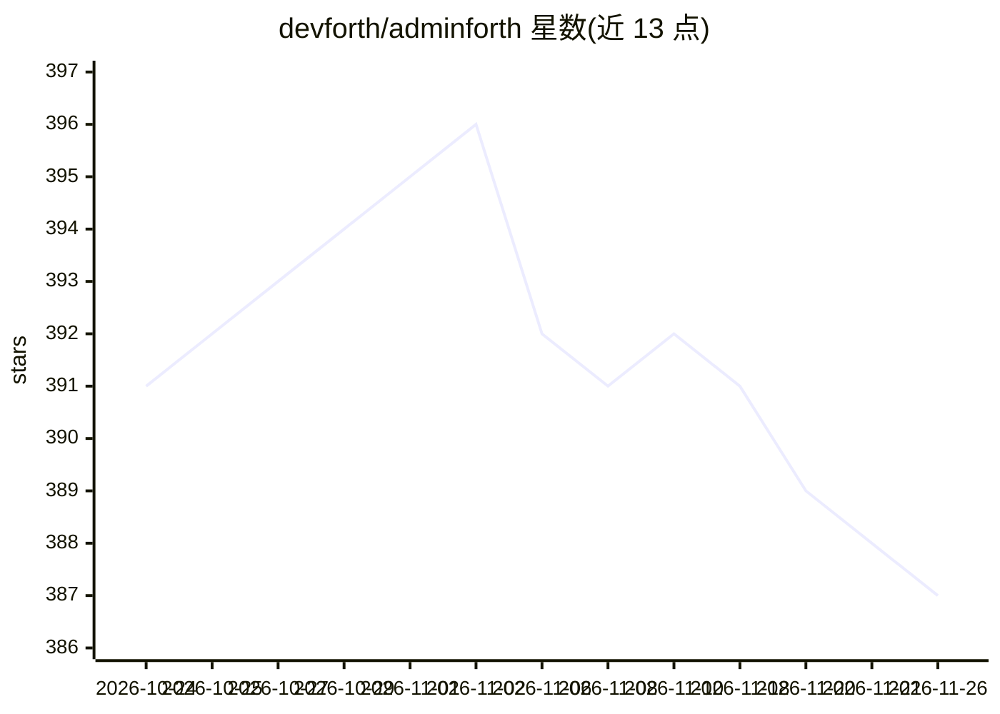

# devforth/adminforth

⭐ 387 · TypeScript · MIT · 推送 2026-11-19 · [GitHub](https://github.com/devforth/adminforth) · [官网](https://adminforth.dev) · 组织维护

**供团队与 AI agent 共用的开源后台管理面板框架**

TypeScript + Vue 3 的后台/业务管理应用框架：声明数据库资源即可生成列表、详情、增删改界面，带过滤、校验与访问控制，并把同一资源暴露为 MCP 工具供 agent 调用。agent 调用走 OAuth 2.1 或按用户可撤销密钥，且受该用户角色权限约束；每次变更写入审计日志并标注操作者与所用 agent。数据源支持 Postgres、MySQL、SQLite、MongoDB、ClickHouse。安装需 Node.js 22.12+ 与 pnpm，MIT 许可、可自托管。

## 筛选速览

| 维度 | 判定 | 备注 |
|---|---|---|
| AI 角色 | `ai-ecosystem` | LLM/agent 周边工具 |
| 许可风险 | `permissive` | MIT |
| 部署形态 | `library` | 以包/库形式分发 |
| 模型依赖 | — | README 未给出锁定关系 |
| 硬件要求 | — | 无带数字的原话,不猜 |
| 安装摩擦 | `low` | 无编译、无系统依赖或容器化 |
| 成熟度 | — | 结构信号不足 |

## 能力要点

- 将数据库资源同时生成管理界面与 MCP 工具
- agent 调用按用户权限执行并写入含 agent 归属的审计日志
- 安全插件：TOTP/passkeys、OAuth SSO、会话撤销、登录验证码
- 生成的应用自带 AGENTS.md/CLAUDE.md 与 skills，文档发布 llms.txt

## 适用场景

- 为自己的业务数据库搭建带权限控制的后台管理面板
- 让编码 agent 生成后台应用后经 MCP 查询和更新业务数据
- 需要审计每条数据变更是谁、经哪个 agent 做的团队

## 场景标签

 · 领域:后台管理/低代码框架

## 证据(README 行号)

> L69: AdminForth is a TypeScript and Vue 3 framework for back-office and business applications. Declare resources over yo
> L72: - **Agents:** the MCP server plugin with OAuth 2.1 sign-in or per-user revocable secrets, every call under the user

## 星数曲线

2026-10-24 391 → 2026-11-26 387（-4）

---
*卡片 v1 · prompt 1.4 · 生成 2026-11-25 · 置信度 mid · 依据 README sha `be1faecd9a87` · [字段定义](../../DATASET.md)*
