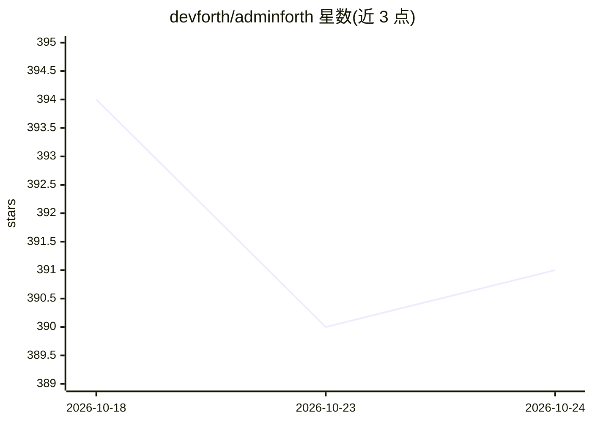

# devforth/adminforth

⭐ 391 · TypeScript · MIT · 推送 2026-10-23 · [GitHub](https://github.com/devforth/adminforth) · [官网](https://adminforth.dev) · 组织维护

**TypeScript/Vue 的 Agent 优先管理后台框架**

面向开发者的管理后台生成框架：通过 npx adminforth create-app 传入数据库 URL（支持 Postgres/MySQL/Mongo/SQLite/Clickhouse）生成完整 CRUD 界面，可用 Vue 组件与内置组件库 AFCL 定制外观，并带审计日志、文件上传、TOTP 2FA、I18N、Copilot 式 AI 写作与图像生成等后-office 插件。要求 Node.js 22.12+/24/26。声明始终免费开源、无付费版本与云订阅。去掉 AI 插件后仍是完整的管理后台框架。

## 筛选速览

| 维度 | 判定 | 备注 |
|---|---|---|
| AI 角色 | `ai-enhanced` | 去掉 AI 部分产品仍成立 |
| 许可风险 | `permissive` | MIT |
| 部署形态 | `library` | 以包/库形式分发 |
| 模型依赖 | — | README 未给出锁定关系 |
| 硬件要求 | — | 无带数字的原话,不猜 |
| 安装摩擦 | `low` | 无编译、无系统依赖或容器化 |
| 成熟度 | — | 结构信号不足 |

## 能力要点

- CLI 从数据库 URL 导入表并生成 CRUD 界面
- 支持 Postgres/MySQL/Mongo/SQLite/Clickhouse 五种数据库
- Vue 组件自定义列/字段/页面，内置 AFCL 组件库
- 插件含审计日志、TOTP 2FA、I18N、Copilot 式 AI 写作与图像生成

## 适用场景

- 基于已有数据库快速搭建后台管理系统
- 在管理页面中直接使用 AI 写作与图像生成
- 通过 Vue 组件扩展后台的表格与自定义页面

## 场景标签

 · 领域:Web 开发/管理后台框架

## 证据(README 行号)

> L1: # AdminForth - powerfull Agent-first Typescript admin panel framework
> L24: * Use various modern back-office-must-have plugins like audit log, files/image upload, TOTP 2FA, I18N, Copilot-styl

## 星数曲线

2026-10-18 394 → 2026-10-24 391（-3）

---
*卡片 v1 · prompt 1.4 · 生成 2026-10-22 · 置信度 high · 依据 README sha `29244f377444` · [字段定义](../../DATASET.md)*
