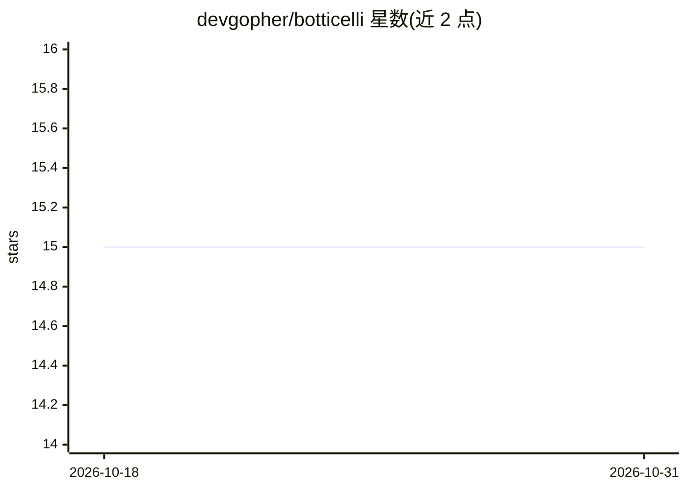

# devgopher/botticelli

⭐ 15 · C# · GPL-3.0 · 推送 2026-06-14 · [GitHub](https://github.com/devgopher/botticelli) · [官网](http://botticellibots.com) · 个人维护

**.NET 聊天机器人开发框架，集成 AI 模型与多消息平台**

面向 .NET 8+ 的开源聊天机器人开发框架，由 Bots 与 Server 两部分组成：Server 端可添加机器人并管理其启停状态，Bot 端实现业务逻辑。框架提供 ChatGPT、DeepSeek、YandexGPT、GPT-J 等 AI 模型接入，SQL/NoSQL 数据库与 RabbitMQ/Kafka 队列支持、TTS/STT 语音模块（Botticelli.Talks）、cron 任务调度和 Web 管理面板，宣称 20-50 行代码可产出生产级机器人。README 未给出具体安装命令，仅链接外部文档与 Telegram 示例。

## 筛选速览

| 维度 | 判定 | 备注 |
|---|---|---|
| AI 角色 | `ai-ecosystem` | LLM/agent 周边工具 |
| 许可风险 | `viral` | GPL-3.0 |
| 部署形态 | `None` |  |
| 模型依赖 | — | README 未给出锁定关系 |
| 硬件要求 | — | 无带数字的原话,不猜 |
| 安装摩擦 | `medium` | 含编译或系统依赖之一 |
| 成熟度 | — | 结构信号不足 |

## 能力要点

- 多平台支持：Telegram 及自定义 provider
- 内置 ChatGPT/DeepSeek/YandexGPT/GPT-J 模型接入
- SQL/NoSQL 数据库与 RabbitMQ/Kafka 队列支持
- TTS/STT 语音模块（Botticelli.Talks）与 Web 管理面板

## 适用场景

- 用 .NET 快速开发 Telegram 聊天机器人
- 构建接入 LLM 的对话式智能体
- 通过 Web 面板集中管理多个机器人的运行状态

## 场景标签

`Agent 框架` · 领域:Agent 开发

## 证据(README 行号)

> L9: **Botticelli** framework: a chat bot development platform for .NET
> L22: ✅ **AI integrations out-of-the-box** – ChatGPT, DeepSeek, YandexGPT, GPT-J

## 星数曲线

2026-10-18 15 → 2026-10-31 15（+0）

---
*卡片 v1 · prompt 1.4 · 生成 2026-10-30 · 置信度 high · 依据 README sha `f47f05b37642` · [字段定义](../../DATASET.md)*
