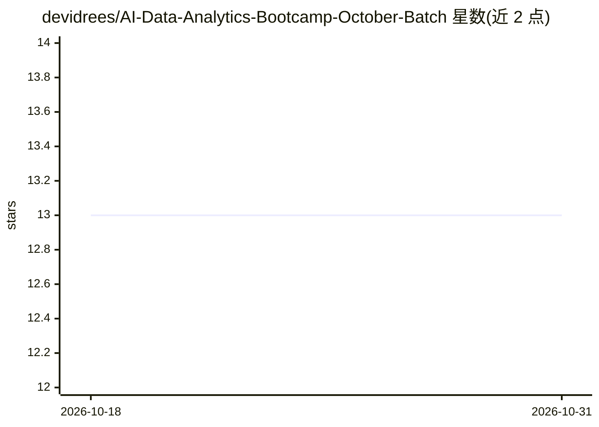

# devidrees/AI-Data-Analytics-Bootcamp-October-Batch

⭐ 13 · Python · 推送 2026-09-26 · [GitHub](https://github.com/devidrees/AI-Data-Analytics-Bootcamp-October-Batch) · 个人维护

**数据分析与 AI 训练营课程配套代码仓库（11 门课程）**

由培训师 Idrees 维护的数据分析与 AI 课程（BDA62 批次）配套仓库，按 11 个课程模块组织，覆盖 Python 编程、数据获取与清洗、EDA 与 Power BI、SQL 与数据仓库、机器学习、特征工程与模型评估、深度学习、NLP 与 LLM、时间序列、大数据与云平台、模型部署与业务分析，含 datasets/notebooks/projects/assignments 目录与结业项目。提供 git clone 与 requirements.txt 安装依赖方式。

## 筛选速览

| 维度 | 判定 | 备注 |
|---|---|---|
| AI 角色 | `ai-knowledge` | 知识聚合/清单类 |
| 许可风险 | `none` | — |
| 部署形态 | `library` | 以包/库形式分发 |
| 模型依赖 | — | README 未给出锁定关系 |
| 硬件要求 | — | 无带数字的原话,不猜 |
| 安装摩擦 | `low` | 无编译、无系统依赖或容器化 |
| 成熟度 | — | 结构信号不足 |

## 能力要点

- 11 个课程模块从 Python 基础到模型部署覆盖数据分析全流程
- 仓库按 datasets/notebooks/projects/assignments 分类组织
- 工具链含 Pandas、Scikit-learn、TensorFlow、Power BI、MySQL

## 适用场景

- 按模块自学数据分析与 AI 课程内容
- 获取课程配套的 notebook、数据集与结业项目
- 查找每周作业与练习材料

## 场景标签

`教程课程` · 领域:学习与行业

## 证据(README 行号)

> L3: Welcome to the **Data Analytics and Artificial Intelligence** course repository! This course is designed to equip yo
> L31: 1. **Course 1: Introduction to Data Analytics, and Python Programming**

## 星数曲线

2026-10-18 13 → 2026-10-31 13（+0）

---
*卡片 v1 · prompt 1.4 · 生成 2026-10-31 · 置信度 mid · 依据 README sha `d6208e0766a3` · [字段定义](../../DATASET.md)*
