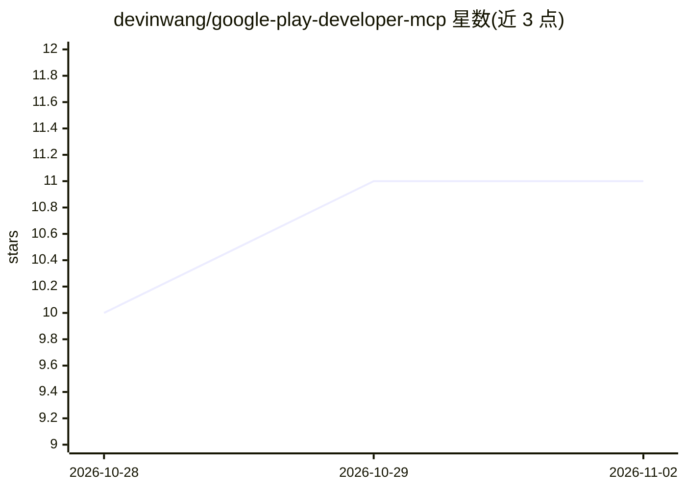

# devinwang/google-play-developer-mcp

⭐ 11 · TypeScript · MIT · 推送 2026-10-21 · [GitHub](https://github.com/devinwang/google-play-developer-mcp) · 个人维护

**面向 Google Play 开发者 API 的 MCP 服务器（157 个工具）**

TypeScript 实现的 Model Context Protocol 服务器，封装 Android Publisher API v3 与 Play Developer Reporting API v1beta1，提供 157 个工具、33 个分组，覆盖应用发布、轨道管理、订阅与一次性商品目录、购买验证、评论回复、退款与崩溃/ANR 报表查询等。通过 MCP 客户端（Claude Desktop/Code、Cursor、VS Code Copilot、Gemini CLI 等）以自然语言驱动 Play Console 操作。安装依赖 npm 全局安装，需自备 Google Cloud 服务账号 JSON 密钥并在 Play Console 授权，权限生效最长需等待 24 小时。仓库不含任何凭据，账号记录文件以 0600 权限存储于本地。

## 筛选速览

| 维度 | 判定 | 备注 |
|---|---|---|
| AI 角色 | `ai-ecosystem` | LLM/agent 周边工具 |
| 许可风险 | `permissive` | MIT |
| 部署形态 | `library` | 以包/库形式分发 |
| 模型依赖 | — | README 未给出锁定关系 |
| 硬件要求 | — | 无带数字的原话,不猜 |
| 安装摩擦 | `low` | 无编译、无系统依赖或容器化 |
| 成熟度 | — | 结构信号不足 |

## 能力要点

- 157 个工具覆盖 Android Publisher API v3 与 Play Developer Reporting API v1beta1 的非废弃端点
- 多账号本地注册管理（accounts_add / list / switch）
- 支持订阅、基础方案、优惠与 2025 后一次性商品目录的完整 CRUD
- 服务账号密钥不入仓库，.gitignore 阻断多种密钥文件模式

## 适用场景

- 用 AI 助手完成 Android 应用从上传 AAB 到分轨道发布的流程
- 管理订阅与一次性商品目录、创建免费试用优惠
- 回复应用评论、核查退款与购买令牌
- 查询崩溃率、ANR 等质量指标做问题排查

## 场景标签

 · 领域:开发者工具/移动应用发布

## 证据(README 行号)

> L3: > **The complete Model Context Protocol (MCP) server for Google Play.**
> L38: If you drive Google Play Console with an AI assistant — release automation, review triage, subscription catalog man

## 星数曲线

2026-10-28 10 → 2026-11-02 11（+1）

---
*卡片 v1 · prompt 1.4 · 生成 2026-11-02 · 置信度 high · 依据 README sha `ef73cdede7c1` · [字段定义](../../DATASET.md)*
