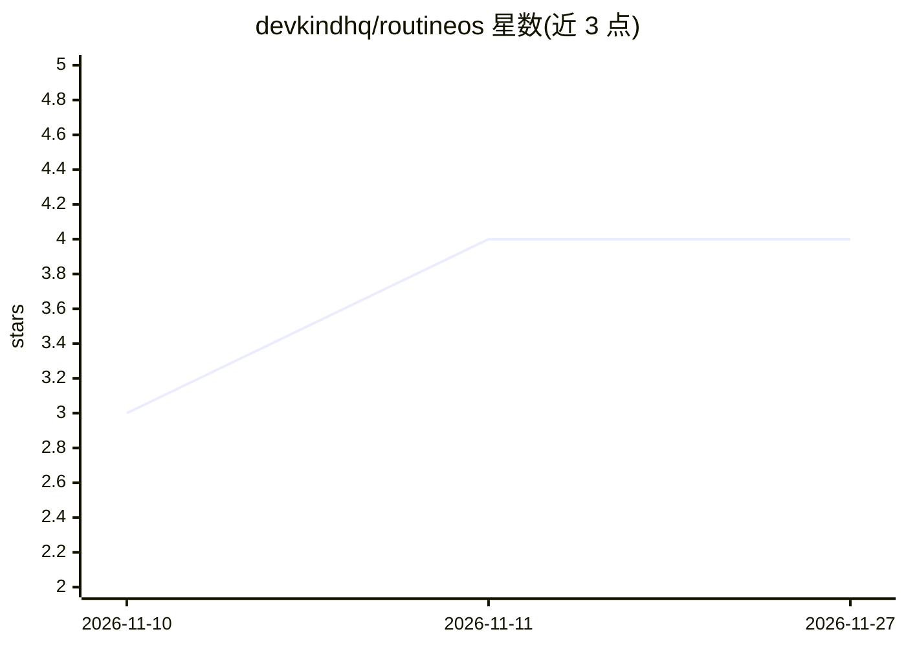

# devkindhq/routineos

⭐ 4 · HTML · MIT · 推送 2026-11-22 · [GitHub](https://github.com/devkindhq/routineos) · [官网](https://routineos.org) · 组织维护

**为 Claude Code 定时任务提供类型化设置与审批门的框架**

一个 MIT 许可的 Claude Code 插件与框架，面向使用 Claude scheduled tasks（云上定时运行 agent）的用户。它为每个 routine 提供带默认值的类型化设置、linter 校验、脚手架模板、审批门与移动端 Desk 页面；基于用户 keep/drop 决策统计信号并建议设置修改，仅经用户确认后应用。首次运行仅报告，发送/发布/删除均需审批。提供 12 个模板包、n8n/Windmill/Zapier 迁移命令和只读 MCP 文档服务器。

## 筛选速览

| 维度 | 判定 | 备注 |
|---|---|---|
| AI 角色 | `ai-ecosystem` | LLM/agent 周边工具 |
| 许可风险 | `permissive` | MIT |
| 部署形态 | `None` |  |
| 模型依赖 | locked-api |  |
| 硬件要求 | — | 无带数字的原话,不猜 |
| 安装摩擦 | `low` | 无编译、无系统依赖或容器化 |
| 成熟度 | `idea` | |

## 能力要点

- 12 个 starter 模板（3 个经真实运行验证），pack 安装与自建支持
- 审批门机制：无确认不发送/发布/删除，首次运行为 report-only
- 从 keep/drop 决策统计信号并生成设置修改建议，永不自行应用
- 文档与模板目录以只读 MCP 服务器形式供 Claude 读取

## 适用场景

- 定时运行 Claude agent 做周报、摘要、站点检查等重复工作
- 邮件分类与回复草稿等需人工审批后发送的流程
- 将现有 n8n/Zapier 工作流迁移为 Claude routine
- 通过 Desk 审阅每次运行记录与待审批操作

## 场景标签

`工作流自动化` · 领域:效率与自动化

## 证据(README 行号)

> L7: RoutineOS is a free, MIT-licensed Claude Code plugin and framework for Claude routines, the scheduled Claude agents 
> L9: Install: `/plugin install routineos --marketplace devkindhq/routineos` (Claude Code 2.1.275 or later). Docs: docs.ro
> L132: A routine is a Claude Code configuration (a prompt, repositories and connectors) that runs on Anthropic's cloud on

## 星数曲线

2026-11-10 3 → 2026-11-27 4（+1）

---
*卡片 v1 · prompt 1.4 · 生成 2026-11-21 · 置信度 high · 依据 README sha `c90a626d21a3` · [字段定义](../../DATASET.md)*
