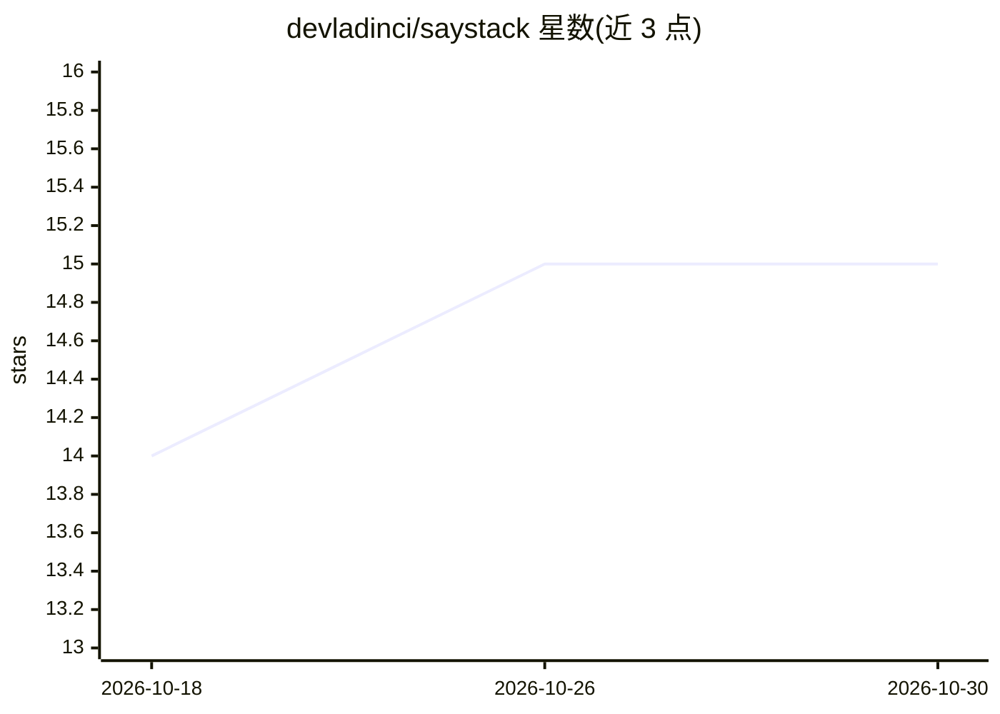

# devladinci/saystack

⭐ 15 · TypeScript · MIT · 推送 2026-10-05 · [GitHub](https://github.com/devladinci/saystack) · [官网](https://devladinci.github.io/saystack/) · 个人维护

**给 LLM 聊天 UI 的语音输入输出库：朗读、跟读高亮与听写**

面向 LLM 聊天界面的语音 I/O 组件集，非框架：核心包无运行时依赖、不绑定厂商，引擎通过 ISttAdapter/ITtsAdapter/ISttRealtimeAdapter 接口接入。功能包括把模型回复转可朗读文本并分块流式播放、逐词高亮跟读、实时听写写入输入框、语音反应频谱光晕 UI，以及用 OpenAI 兼容聊天模型改写不适合朗读的回复。提供 core/web/react/react-native/server 等分包及 OpenAI 兼容引擎包；端到端测试覆盖 oMLX 与 Speaches+Ollama。声明 pre-1.0，API 可能在次版本变化。

## 筛选速览

| 维度 | 判定 | 备注 |
|---|---|---|
| AI 角色 | `ai-ecosystem` | LLM/agent 周边工具 |
| 许可风险 | `permissive` | MIT |
| 部署形态 | `library` | 以包/库形式分发 |
| 模型依赖 | local-ok | 支持本地模型 |
| 硬件要求 | — | 无带数字的原话,不猜 |
| 安装摩擦 | `low` | 无编译、无系统依赖或容器化 |
| 成熟度 | `idea` | |

## 能力要点

- 回复转可朗读文本并分块，音频可在回复完成前开始播放
- 逐词高亮跟读（含引擎提供的词级时间戳）
- 实时 WebSocket 听写与普通上传听写两条路径
- 适配任意 OpenAI 兼容 /v1 服务器的 STT/TTS/Realtime 引擎包

## 适用场景

- 给自己的 LLM 聊天应用加语音朗读与逐词高亮
- 在 Web 或 React Native 应用中实现实时听写
- 对含数字/链接/代码的回复先经 LLM 改写再朗读

## 场景标签

`语音合成` `语音识别` · 领域:内容生成

## 证据(README 行号)

> L14: It is a set of small, separately installable pieces rather than a framework. `@saystack/core` has no
> L39: - **Engines behind a seam.** `ISttAdapter`, `ITtsAdapter` and `ISttRealtimeAdapter` are the only things
> L59: |`@saystack/engine-openai-compatible`|An engine for any OpenAI-compatible `/v1` server: STT, TTS, OpenAI Realtime l

## 星数曲线

2026-10-18 14 → 2026-10-30 15（+1）

---
*卡片 v1 · prompt 1.4 · 生成 2026-10-30 · 置信度 high · 依据 README sha `b38c26e3a0ab` · [字段定义](../../DATASET.md)*
