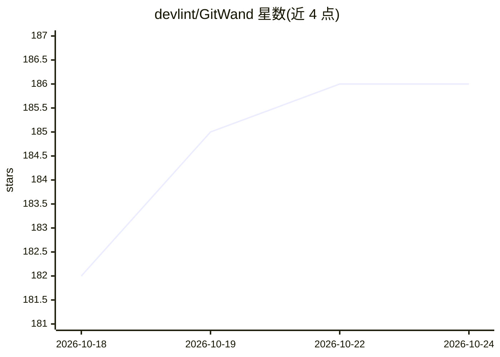

# devlint/GitWand

⭐ 186 · TypeScript · MIT · 推送 2026-10-19 · [GitHub](https://github.com/devlint/GitWand) · [官网](https://gitwand.app) · 组织维护 · 中文 README

**带智能冲突自动解决与 AI 辅助的原生 Git 桌面客户端**

基于 Tauri 2 + Vue 3 的原生 Git 桌面客户端，覆盖变更、历史、分支、推送/拉取的日常流程。核心是 @gitwand/core 冲突解决引擎：模式注册表含 12 个模式，其中 8 个自动应用（如双方相同修改、单侧修改、空白差异、重排序等），llm_proposed 为可选的模型提议式解决，复杂冲突保留完整痕迹。另含跨 GitHub/GitLab/Bitbucket/Azure DevOps 的 PR 审查、Git Tree DAG 历史视图、MCP Agent 会话、集成终端（可启动 Claude Code/Codex）、AI 任务隔离 worktree。通过 Releases 安装包、winget 或源码运行。

## 筛选速览

| 维度 | 判定 | 备注 |
|---|---|---|
| AI 角色 | `ai-enhanced` | 去掉 AI 部分产品仍成立 |
| 许可风险 | `permissive` | MIT |
| 部署形态 | `desktop` | 安装包/桌面程序 |
| 模型依赖 | local-ok | 支持本地模型 |
| 硬件要求 | — | 无带数字的原话,不猜 |
| 安装摩擦 | `low` | 无编译、无系统依赖或容器化 |
| 成熟度 | — | 结构信号不足 |

## 能力要点

- 冲突引擎：12 个模式中 8 个自动应用，附复合置信度分数
- 生成文件（lockfile/dist 等）默认拒绝自动合并并给出可操作理由
- 跨 GitHub/GitLab/Bitbucket/Azure DevOps 的 PR 浏览、审查与合并，OAuth 设备流登录
- 集成终端含 AI agent 标签页，一键在隔离 worktree 中启动 AI 任务

## 适用场景

- 日常 Git 操作中自动解决琐碎合并冲突
- 合并前预览冲突结果，按可自动解决/需人工分级处理
- 在客户端内完成跨平台的 PR 审查与 CI 注解查看
- 在隔离 worktree 中让 Claude Code/Codex 执行任务后合并回主分支

## 场景标签

`代码审查` · 领域:编码与开发

## 证据(README 行号)

> L5:  A fast, native Git client with built-in smart conflict resolution
> L23: GitWand is a lightweight, native Git client built with Tauri 2 and Vue 3. It covers the full daily workflow — chang
> L99: Language (English, French, Spanish, Brazilian Portuguese, Simplified Chinese — OS auto-detected), theme (dark/light

## 星数曲线

2026-10-18 182 → 2026-10-24 186（+4）

---
*卡片 v1 · prompt 1.4 · 生成 2026-10-22 · 置信度 mid · 依据 README sha `22533b314b6e` · [字段定义](../../DATASET.md)*
