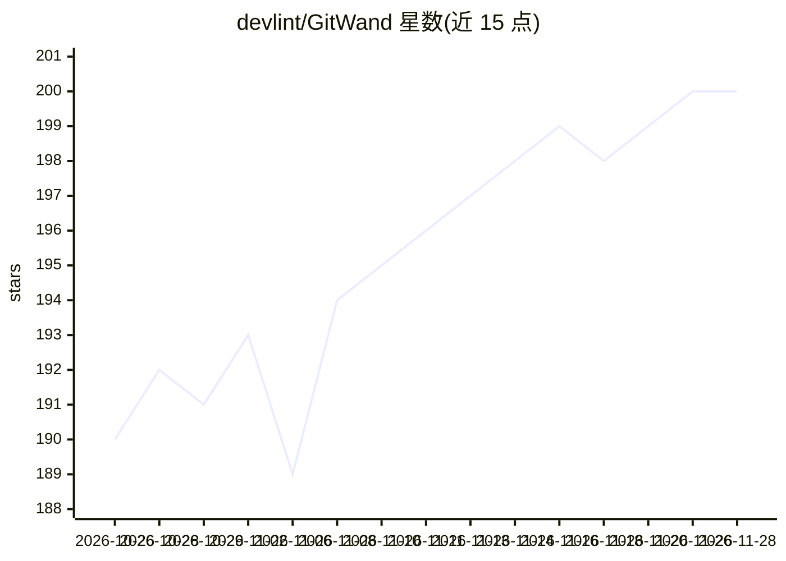

# devlint/GitWand

⭐ 200 · TypeScript · MIT · 推送 2026-11-27 · [GitHub](https://github.com/devlint/GitWand) · [官网](https://gitwand.app) · 组织维护

**面向开发者的原生 Git 客户端，内置琐碎冲突自动解决**

基于 Tauri 2 与 Vue 3 的桌面 Git 客户端，覆盖变更、历史、分支、push/pull 等日常工作流；冲突引擎用 12 个模式注册表（8 个自动应用）处理琐碎合并冲突，每个 hunk 输出置信度分数，复杂冲突保留完整痕迹。集成 PR 审查（支持 GitHub/GitLab/Bitbucket/Azure DevOps/Gitea/Forgejo）、Git Tree DAG 历史视图、多仓库 Workspaces 与 worktree 管理。v1.3 起 AI 覆盖分支命名、PR 撰写、hunk 级审查、语义 squash、自然语言提交搜索；终端支持 Claude Code/Codex 标签页并在隔离 worktree 中运行 AI 任务。

## 筛选速览

| 维度 | 判定 | 备注 |
|---|---|---|
| AI 角色 | `ai-enhanced` | 去掉 AI 部分产品仍成立 |
| 许可风险 | `permissive` | MIT |
| 部署形态 | `desktop` | 安装包/桌面程序 |
| 模型依赖 | local-ok | 支持本地模型 |
| 硬件要求 | — | 无带数字的原话,不猜 |
| 安装摩擦 | `low` | 无编译、无系统依赖或容器化 |
| 成熟度 | — | 结构信号不足 |

## 能力要点

- 冲突模式注册表：12 个模式、8 个自动应用，输出置信度分数
- 支持六种代码托管平台的 PR 浏览、创建与内联审查
- Agent Sessions 与 MCP 目录，可在隔离 worktree 中一键启动 AI 任务
- 跨三大桌面平台提供签名安装包

## 适用场景

- 日常 Git 工作流：暂存、提交、分支、push/pull
- 合并前预览冲突结果，自动解决琐碎冲突
- 在一个应用内跨多个托管平台做 PR 审查
- 从客户端直接启动 Claude Code/Codex 处理任务

## 场景标签

`代码审查` · 领域:编码与开发

## 证据(README 行号)

> L23: GitWand is a lightweight, native Git client built with Tauri 2 and Vue 3. It covers the full daily workflow — chang
> L91: The **terminal panel** (v3.2) renders through WebGL with inline search (`Ctrl+F`), clickable links, and typed tabs 
> L126: GitWand's core engine (`@gitwand/core`) automatically resolves trivial Git merge conflicts. It never touches compl

## 星数曲线

2026-10-26 190 → 2026-11-28 200（+10）

---
*卡片 v1 · prompt 1.4 · 生成 2026-11-26 · 置信度 mid · 依据 README sha `909fadacd2c7` · [字段定义](../../DATASET.md)*
