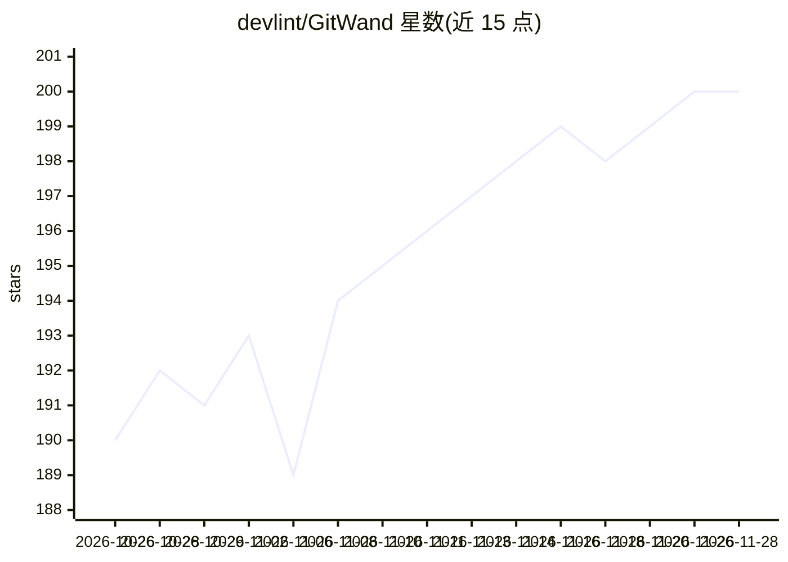

# devlint/GitWand

⭐ 200 · TypeScript · MIT · 推送 2026-11-27 · [GitHub](https://github.com/devlint/GitWand) · [官网](https://gitwand.app) · 个人维护

**给开发者的 Git 客户端：自动解决琐碎合并冲突并集成 AI 工作流**

基于 Tauri 2 + Vue 3 的原生桌面 Git 客户端，覆盖改动、历史、分支、push/pull 等日常流程。核心是确定性冲突解决引擎：12 个模式中 8 个自动应用，其余交由人工并给出完整追踪，每个 hunk 携带组合置信分。另集成 PR 代码审查（支持 GitHub/GitLab/Bitbucket/Azure DevOps/Gitea/Forgejo）、MCP Agent 会话、AI 终端标签页、内联 AI 审查等 AI 辅助功能。通过 GitHub Releases 提供安装包，MIT 许可。

## 筛选速览

| 维度 | 判定 | 备注 |
|---|---|---|
| AI 角色 | `ai-enhanced` | 去掉 AI 部分产品仍成立 |
| 许可风险 | `permissive` | MIT |
| 部署形态 | `desktop` | 安装包/桌面程序 |
| 模型依赖 | local-ok | 支持本地模型 |
| 硬件要求 | — | 无带数字的原话,不猜 |
| 安装摩擦 | `low` | 无编译、无系统依赖或容器化 |
| 成熟度 | — | 结构信号不足 |

## 能力要点

- 12 个确定性冲突解决模式，8 个自动应用，复杂冲突给出完整追踪
- 合并前预览引擎基于 git merge-base/merge-file 模拟结果
- PR 工作流支持 6 个代码托管平台，OAuth 设备流登录
- 集成终端含 claude/codex 标签页，AI 任务在隔离 worktree 中运行

## 适用场景

- 日常 Git 操作中减少琐碎合并冲突的手工处理
- 在一个应用内跨多个代码托管平台浏览与审查 PR
- 在隔离 worktree 中启动 AI agent 完成任务后合并回主分支

## 场景标签

`代码审查` `编码 Agent` · 领域:编码与开发

## 证据(README 行号)

> L23: GitWand is a lightweight, native Git client built with Tauri 2 and Vue 3. It covers the full daily workflow — chang
> L99: Language (English, French, Spanish, Brazilian Portuguese, Simplified Chinese — OS auto-detected), theme (dark/light
> L126: GitWand's core engine (`@gitwand/core`) automatically resolves trivial Git merge conflicts. It never touches compl

## 星数曲线

2026-10-26 190 → 2026-11-28 200（+10）

---
*卡片 v1 · prompt 1.4 · 生成 2026-11-28 · 置信度 mid · 依据 README sha `e3c36a76b4a9` · [字段定义](../../DATASET.md)*
