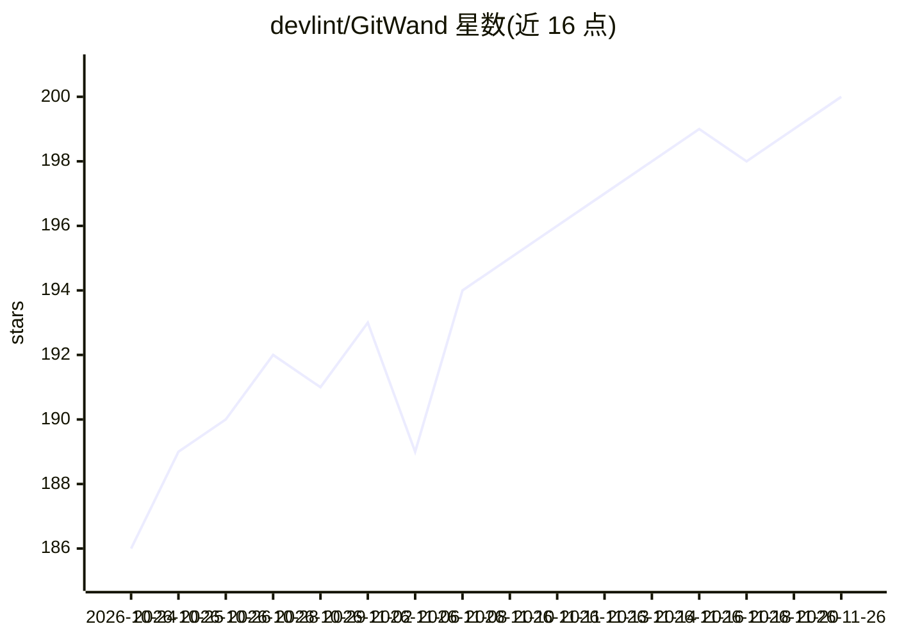

# devlint/GitWand

⭐ 200 · TypeScript · MIT · 推送 2026-11-25 · [GitHub](https://github.com/devlint/GitWand) · [官网](https://gitwand.app) · 个人维护

**给开发者解决合并冲突与日常 Git 工作流的桌面客户端**

基于 Tauri 2 + Rust/Vue 3 的原生 Git 客户端，覆盖日常变更、历史、分支、push/pull 流程；核心是冲突解决引擎，用 12 个模式注册表（8 个自动应用）自动处理琐碎冲突，其余以带置信分数与完整轨迹的方式交还用户。应用内提供 Git Tree 历史视图、跨 forge 的 PR 审查（GitHub/GitLab/Bitbucket/Azure DevOps/Gitea/Forgejo）、集成终端、Agent Sessions（MCP）与 AI 辅助功能（分支命名、PR 撰写、hunk 级审查、自然语言提交搜索）。提供桌面安装包与源码运行方式。

## 筛选速览

| 维度 | 判定 | 备注 |
|---|---|---|
| AI 角色 | `ai-enhanced` | 去掉 AI 部分产品仍成立 |
| 许可风险 | `permissive` | MIT |
| 部署形态 | `desktop` | 安装包/桌面程序 |
| 模型依赖 | local-ok | 支持本地模型 |
| 硬件要求 | — | 无带数字的原话,不猜 |
| 安装摩擦 | `low` | 无编译、无系统依赖或容器化 |
| 成熟度 | — | 结构信号不足 |

## 能力要点

- 冲突解决引擎：12 个模式中 8 个自动应用，每个 hunk 携带组合置信分数
- 跨 6 种 forge 的 PR 浏览/创建/审查与 OAuth 设备流登录
- 集成终端带 claude/codex 类型 AI agent 标签页与隔离 worktree 任务
- Git Tree 全分辨率 DAG 历史、合并预览与 Today 跨仓库行动收件箱

## 适用场景

- 日常 Git 仓库管理中自动解决无歧义的合并冲突
- 在一个客户端里跨 GitHub/GitLab 等平台处理 PR 审查
- 从应用内直接启动 Claude Code/Codex 并在隔离 worktree 中执行 AI 任务

## 场景标签

`代码审查` · 领域:编码与开发

## 证据(README 行号)

> L23: GitWand is a lightweight, native Git client built with Tauri 2 and Vue 3. It covers the full daily workflow — chang
> L99: Language (English, French, Spanish, Brazilian Portuguese, Simplified Chinese — OS auto-detected), theme (dark/light
> L126: GitWand's core engine (`@gitwand/core`) automatically resolves trivial Git merge conflicts. It never touches compl

## 星数曲线

2026-10-24 186 → 2026-11-26 200（+14）

---
*卡片 v1 · prompt 1.4 · 生成 2026-11-25 · 置信度 mid · 依据 README sha `e06b777d9e16` · [字段定义](../../DATASET.md)*
