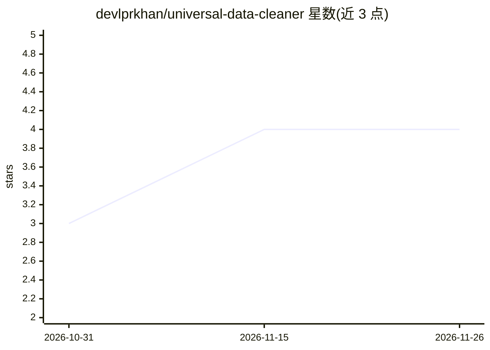

# devlprkhan/universal-data-cleaner

⭐ 4 · Python · MIT · 推送 2026-11-25 · [GitHub](https://github.com/devlprkhan/universal-data-cleaner) · 个人维护

**面向 pandas 表格数据的生产级 scikit-learn 兼容清洗转换器**

以 scikit-learn transformer 形式提供的表格数据清洗库：fit/transform 分离，训练时学习中位数、众数、离群值边界、类别值和日期规则，推理时按同一套规则应用，避免数据泄漏。功能覆盖缺失值填充、IQR 离群值封顶、布尔/日期转换与日历特征、契约驱动的 CSV/Excel/Parquet 读取、漂移报告、去重、泄漏审计、joblib 持久化与 CLI。以 pip/uv 安装，兼容 sklearn Pipeline，带 MkDocs 文档与基准测试套件。

## 筛选速览

| 维度 | 判定 | 备注 |
|---|---|---|
| AI 角色 | `ai-ecosystem` | LLM/agent 周边工具 |
| 许可风险 | `permissive` | MIT |
| 部署形态 | `library` | 以包/库形式分发 |
| 模型依赖 | — | README 未给出锁定关系 |
| 硬件要求 | — | 无带数字的原话,不猜 |
| 安装摩擦 | `low` | 无编译、无系统依赖或容器化 |
| 成熟度 | — | 结构信号不足 |

## 能力要点

- leak-safe 设计：fit 只在训练集上学习规则，transform 只应用存储规则
- CleanerReport 汇聚剖析、契约漂移、验证与清洗决策，附 data-cleaner audit CLI
- 支持 transform_chunks() 分块处理与漂移报告聚合
- 兼容 scikit-learn Pipeline、clone 与 get_feature_names_out

## 适用场景

- 在 ML 管道中保证训练与推理数据用同一套规则清洗
- 团队间传递可复现的数据清洗工件（决策日志、清单、指纹）
- 对超出内存的大文件分块流式清洗并聚合报告
- 审计 train/test 划分中的重复、分组、时间与目标泄漏

## 场景标签

 · 领域:数据预处理/MLOps

## 证据(README 行号)

> L10: A small, production-oriented tabular cleaning transformer for pandas + scikit-learn.
> L12: It is designed for the part of an ML pipeline that is easy to get wrong: cleaning
> L113: - scikit-learn `Pipeline`, `clone`, and `get_feature_names_out` compatibility

## 星数曲线

2026-10-31 3 → 2026-11-26 4（+1）

---
*卡片 v1 · prompt 1.4 · 生成 2026-11-21 · 置信度 high · 依据 README sha `b2171fdfadd6` · [字段定义](../../DATASET.md)*
