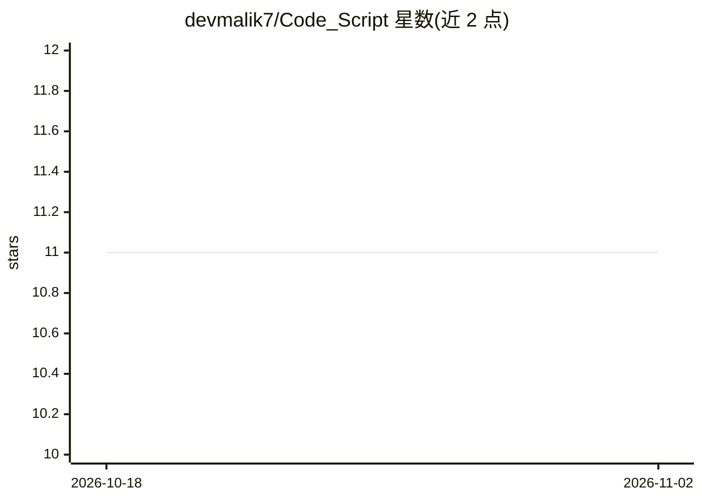

# devmalik7/Code_Script

⭐ 11 · Python · MIT · 推送 2025-11-19 · [GitHub](https://github.com/devmalik7/Code_Script) · 个人维护

**面向 Hacktoberfest 的多语言入门脚本贡献集合**

面向新手参与 Hacktoberfest 的开源贡献型仓库：任何人可以在 Python、JavaScript、Bash 等文件夹下提交简短、带注释的入门脚本，示例包括 BMI 计算器、密码生成器、倒计时器、文件重命名器等。仓库提供贡献流程说明（认领 Issue、Fork、按目录放置文件、提交 PR）与贡献规范，采用 MIT 许可证。README 本身不含可安装运行的产品入口，仓库内容为按目录组织的脚本合集。

## 筛选速览

| 维度 | 判定 | 备注 |
|---|---|---|
| AI 角色 | `ai-knowledge` | 知识聚合/清单类 |
| 许可风险 | `permissive` | MIT |
| 部署形态 | `None` |  |
| 模型依赖 | — | README 未给出锁定关系 |
| 硬件要求 | — | 无带数字的原话,不猜 |
| 安装摩擦 | `low` | 无编译、无系统依赖或容器化 |
| 成熟度 | — | 结构信号不足 |

## 能力要点

- 覆盖 Python / JavaScript / Bash 等语言的入门脚本目录
- 提供完整的 Hacktoberfest 贡献流程与规范（一次 PR 一个脚本等）
- MIT 许可证

## 适用场景

- 新手寻找首次开源贡献（Hacktoberfest）的目标仓库
- 查阅简单的入门级脚本示例（BMI 计算、密码生成等）
- 通过提交 PR 练习开源协作流程

## 场景标签

 · 领域:编程学习/开源社区

## 证据(README 行号)

> L3: Welcome to **Code Script** 🎉 — a beginner-friendly repo for Hacktoberfest!
> L4: Here, anyone can contribute simple, fun, and useful scripts in **Python, JavaScript, Bash, or other beginner-friendl

## 星数曲线

2026-10-18 11 → 2026-11-02 11（+0）

---
*卡片 v1 · prompt 1.4 · 生成 2026-11-02 · 置信度 mid · 依据 README sha `e84bee573031` · [字段定义](../../DATASET.md)*
