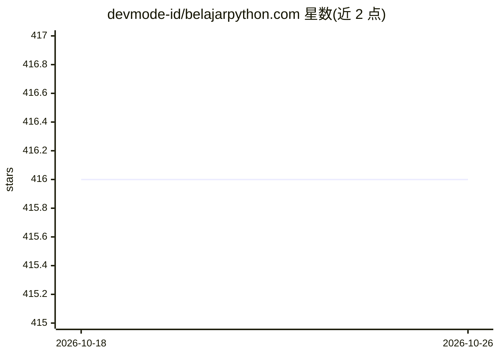

# devmode-id/belajarpython.com

⭐ 416 · Nunjucks · MIT · 推送 2026-05-21 · [GitHub](https://github.com/devmode-id/belajarpython.com) · [官网](https://belajarpython.com) · 组织维护

**印尼语 Python 编程教程协作社区站点**

面向印尼语使用者的开源协作式 Python 编程教程网站：提供从基础开始的入门教程、社区撰写的 Python 文章，以及社区问答功能。站点以开源方式由开发者社区维护，开发者、学生、教师等任何人可参与内容贡献；设有行为准则、贡献指南与 good first issues 列表供新人上手。项目采用 MIT 许可证发布。

## 筛选速览

| 维度 | 判定 | 备注 |
|---|---|---|
| AI 角色 | `ai-knowledge` | 知识聚合/清单类 |
| 许可风险 | `permissive` | MIT |
| 部署形态 | `None` |  |
| 模型依赖 | — | README 未给出锁定关系 |
| 硬件要求 | — | 无带数字的原话,不猜 |
| 安装摩擦 | `low` | 无编译、无系统依赖或容器化 |
| 成熟度 | — | 结构信号不足 |

## 能力要点

- 面向初学者的印尼语 Python 基础教程
- 社区撰写并面向社区的 Python 文章板块
- 开放贡献流程（贡献指南、good first issues、行为准则）

## 适用场景

- 印尼语初学者系统学习 Python 编程
- 阅读社区撰写的 Python 相关文章
- 参与开源教程内容的共建与问答

## 场景标签

`教程课程` · 领域:学习与行业

## 证据(README 行号)

> L3: Belajarpython adalah situs kolaboratif tutorial pemrograman Python bahasa Indonesia
> L5: - **Ikuti Tutorial:** Mulai belajar bahasa pemrograman python dari tingkat dasar dengan tutorial yang dikhususkan un

## 星数曲线

2026-10-18 416 → 2026-10-26 416（+0）

---
*卡片 v1 · prompt 1.4 · 生成 2026-10-21 · 置信度 high · 依据 README sha `a75b1351b310` · [字段定义](../../DATASET.md)*
