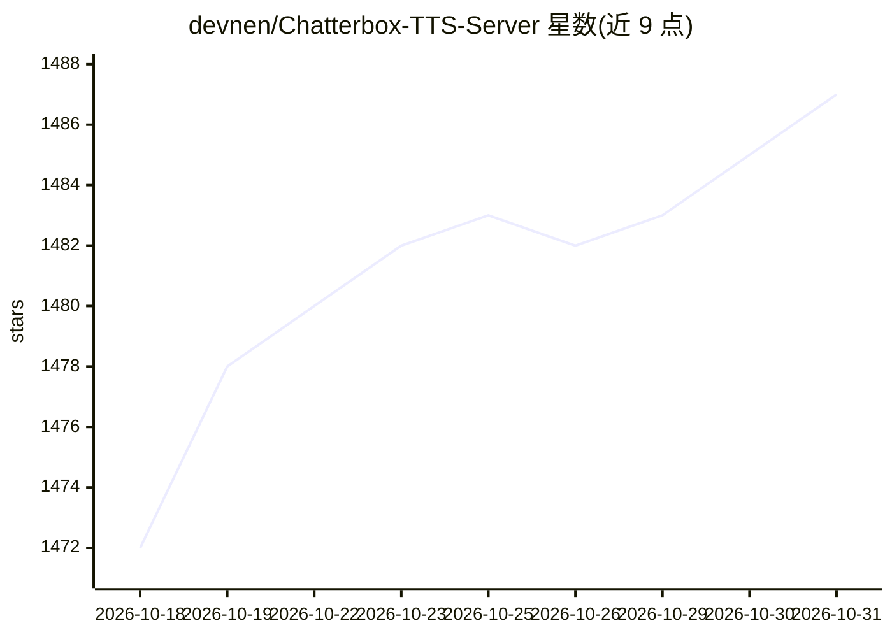

# devnen/Chatterbox-TTS-Server

⭐ 1,487 · Python · MIT · 推送 2026-05-26 · [GitHub](https://github.com/devnen/Chatterbox-TTS-Server) · [官网](https://colab.research.google.com/github/devnen/Chatterbox-TTS-Server/blob/main/Chatterbox_TTS_Colab_Demo.ipynb) · 个人维护

**自托管 Chatterbox TTS 的 OpenAI 兼容 API 服务器与 Web UI**

基于 FastAPI 的自托管 TTS 服务器，封装 Resemble AI 的 Chatterbox 全系列模型（Original 英语 0.5B、Multilingual 23 语言、Turbo 350M）。提供 Web UI、OpenAI 兼容 API、流式 /tts 端点、预置音色、零样本语音克隆、种子可复现生成，以及通过智能分块处理长文本的有声书生成。支持 NVIDIA(CUDA)/AMD(ROCm)/Apple Silicon(MPS) 加速并自动回退 CPU；要求 Python 3.10，Windows 提供 Portable Mode 免装 Python，多平台提供 Docker 镜像与自动启动器。

## 筛选速览

| 维度 | 判定 | 备注 |
|---|---|---|
| AI 角色 | `ai-native` | 本体是模型或模型工具 |
| 许可风险 | `permissive` | MIT |
| 部署形态 | `desktop` | 安装包/桌面程序 |
| 模型依赖 | — | README 未给出锁定关系 |
| 硬件要求 | `cpu-ok` | |
| 安装摩擦 | `low` | 无编译、无系统依赖或容器化 |
| 成熟度 | — | 结构信号不足 |

## 能力要点

- Chatterbox 三模型（Original/Multilingual/Turbo）热切换，UI 内即时更换无需重启
- OpenAI 兼容 API（含流式 /tts、/v1/audio/speech、/v1/audio/voices）
- 零样本语音克隆、预置音色与生成种子，长文本分块与有声书生成
- CUDA/ROCm/MPS 加速，CPU 回退；Windows 便携模式含嵌入式 Python 3.10

## 适用场景

- 自托管 TTS 服务，供 OpenAI 兼容客户端调用语音生成
- 用 Web UI 做语音克隆实验与音色/参数调优
- 把长篇文本批量生成为有声书
- 为 23 种语言的语音 agent 或旁白提供多语言合成

## 场景标签

`语音合成` · 领域:内容生成

## 证据(README 行号)

> L3: **Self-host Resemble AI's Chatterbox open-source TTS family (Original + Multilingual + Turbo) behind an OpenAI‑compa
> L117: The Chatterbox TTS model by Resemble AI provides capabilities for generating high-quality speech. This project bui
> L127: * **Multi-Platform Acceleration:** Full support for **NVIDIA (CUDA)**, **AMD (ROCm)**, and **Apple Silicon (MPS)**

## 星数曲线

2026-10-18 1,472 → 2026-10-31 1,487（+15）

---
*卡片 v1 · prompt 1.4 · 生成 2026-10-21 · 置信度 high · 依据 README sha `d1879f0f513d` · [字段定义](../../DATASET.md)*
