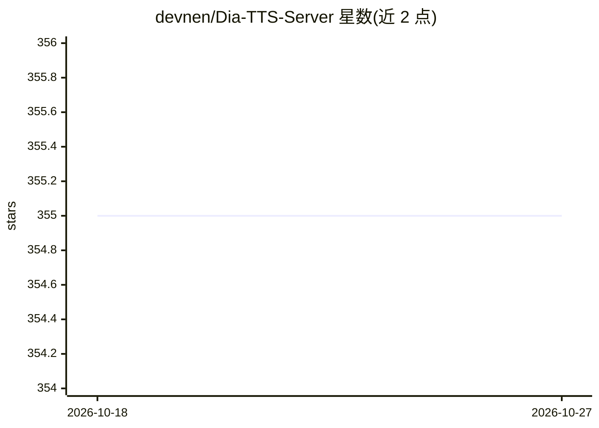

# devnen/Dia-TTS-Server

⭐ 355 · Python · MIT · 推送 2026-03-28 · [GitHub](https://github.com/devnen/Dia-TTS-Server) · 个人维护

**自托管 Dia TTS 模型的 FastAPI 服务器，含 Web UI 与 OpenAI 兼容 API**

基于 FastAPI 的 Dia 系列语音合成自托管服务器，支持 Dia 1.6B、Dia2-1B、Dia2-2B 三模型热切换（不重启服务器），从 Web UI 直接切换。提供 OpenAI 兼容端点 /v1/audio/speech 与自定义 /tts 端点，支持 [S1]/[S2] 多说话人对话生成、非语言声音、43 个预置音色、语音克隆（Whisper 实验性兜底转写）、固定种子一致性生成与长文本智能分块。默认 BF16 SafeTensors 降低显存占用，NVIDIA GPU（CUDA）自动加速并支持 CPU 回退，提供 Docker 容器化部署与 Swagger 文档。

## 筛选速览

| 维度 | 判定 | 备注 |
|---|---|---|
| AI 角色 | `ai-ecosystem` | LLM/agent 周边工具 |
| 许可风险 | `permissive` | MIT |
| 部署形态 | `self-host` | docker 或自建部署 |
| 模型依赖 | — | README 未给出锁定关系 |
| 硬件要求 | `gpu-8g` | |
| 安装摩擦 | `low` | 无编译、无系统依赖或容器化 |
| 成熟度 | — | 结构信号不足 |

## 能力要点

- 三模型（Dia 1.6B / Dia2-1B / Dia2-2B）热切换，后台线程加载不中断服务
- OpenAI 兼容端点 /v1/audio/speech 与全参数 /tts 端点
- 43 个预置音色、语音克隆与固定种子一致性生成
- 长文本按句子与说话人标签智能分块后拼接音频

## 适用场景

- 自托管 TTS 服务并接入期望 OpenAI API 结构的工具
- 生成带说话人轮次与非语言声音的多角色对话音频
- 用参考音频克隆音色并保持多次生成的一致性

## 场景标签

`语音合成` · 领域:内容生成

## 证据(README 行号)

> L3: **Self-host the powerful Nari Labs Dia TTS models — including the original **Dia 1.6B** and the new **Dia 2** family
> L27: * An **OpenAI-compatible API endpoint**, allowing you to use Dia TTS with tools expecting OpenAI's API structure.

## 星数曲线

2026-10-18 355 → 2026-10-27 355（+0）

---
*卡片 v1 · prompt 1.4 · 生成 2026-10-21 · 置信度 high · 依据 README sha `9d416455c2e4` · [字段定义](../../DATASET.md)*
