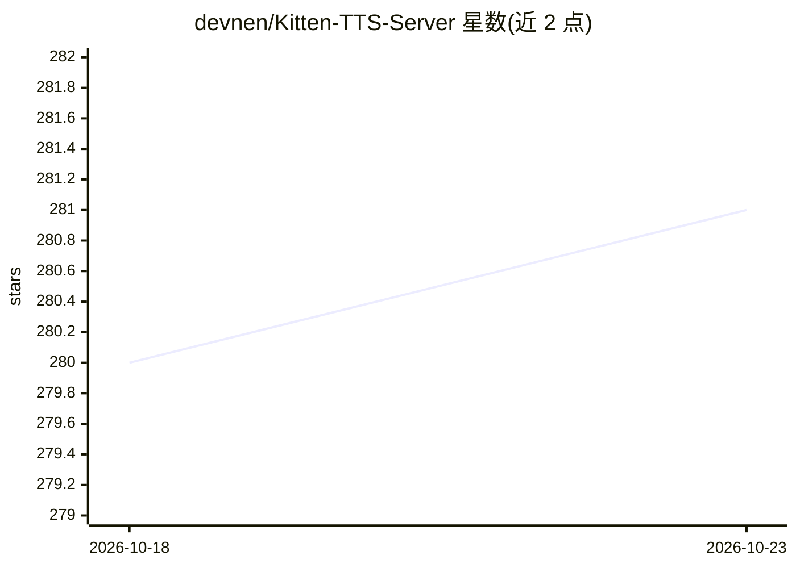

# devnen/Kitten-TTS-Server

⭐ 281 · Python · MIT · 推送 2026-03-28 · [GitHub](https://github.com/devnen/Kitten-TTS-Server) · 个人维护

**自托管 KittenTTS 模型的 API 服务器，带 Web UI 与 GPU 加速**

基于 FastAPI 的自托管语音合成服务：封装 KittenTTS 全部 7 个模型（15M Nano 至 80M Mini），支持 Web UI 内热切换模型、自动从 Hugging Face 下载并缓存、最多 8 个命名音色。长文本自动分句处理并拼接音频，可用于有声书生成。提供 /tts 端点与 OpenAI 兼容端点，支持 NVIDIA GPU（onnxruntime-gpu + I/O Binding）、CPU 及树莓派 5 运行，附 Docker 部署方式。必需依赖 eSpeak NG（文本音素化）。

## 筛选速览

| 维度 | 判定 | 备注 |
|---|---|---|
| AI 角色 | `ai-ecosystem` | LLM/agent 周边工具 |
| 许可风险 | `permissive` | MIT |
| 部署形态 | `desktop` | 安装包/桌面程序 |
| 模型依赖 | — | README 未给出锁定关系 |
| 硬件要求 | — | 无带数字的原话,不猜 |
| 安装摩擦 | `low` | 无编译、无系统依赖或容器化 |
| 成熟度 | — | 结构信号不足 |

## 能力要点

- 7 个 KittenTTS 模型热切换，自动从 Hugging Face 下载缓存
- OpenAI 兼容端点 /v1/audio/speech 与自有 /tts 端点
- NVIDIA CUDA GPU 加速（onnxruntime-gpu + I/O Binding），亦支持 CPU 与树莓派 5
- 长文本自动分句、顺序处理并拼接音频，面向有声书生成

## 适用场景

- 在本地或局域网自托管轻量 TTS 服务并通过 API 调用
- 把长篇文本批量转成有声书音频
- 在树莓派 5 等边缘设备上运行离线语音合成

## 场景标签

`语音合成` · 领域:内容生成

## 证据(README 行号)

> L3: **Self-host the ultra-lightweight KittenTTS model with this enhanced API server. Now supports all 7 KittenTTS models
> L61: The KittenTTS model by KittenML provides a foundation for generating high-quality speech from models smaller than 8
> L69: * **A flexible, dual-API system** including a simple endpoint and an OpenAI-compatible endpoint for easy integratio

## 星数曲线

2026-10-18 280 → 2026-10-23 281（+1）

---
*卡片 v1 · prompt 1.4 · 生成 2026-10-22 · 置信度 high · 依据 README sha `7ad9e807dd6f` · [字段定义](../../DATASET.md)*
