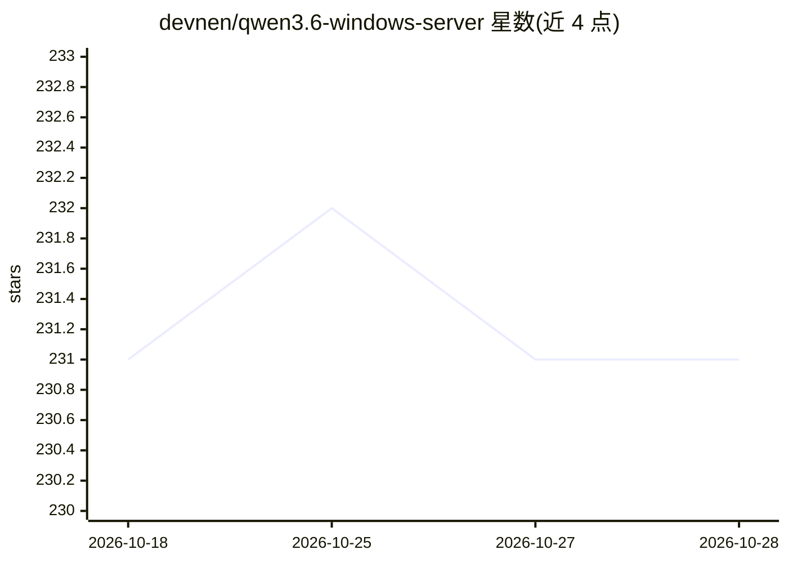

# devnen/qwen3.6-windows-server

⭐ 231 · Python · 推送 2026-05-14 · [GitHub](https://github.com/devnen/qwen3.6-windows-server) · 个人维护

**Windows 一键本地运行 Qwen3.6-27B 的 vLLM 服务启动器**

面向 Windows 用户的便携式启动器：解压双击后在 http://127.0.0.1:5001/v1 提供 OpenAI 兼容 API，本地运行 Qwen3.6-27B（Lorbus AutoRound INT4）。内置嵌入式 Python 3.12 与修补过的 vLLM wheel，无需 WSL/Docker/conda/管理员权限；以 Textual TUI 管理多个实测调优的性能快照（不同上下文长度、MTP 设置、单/双 GPU），支持命令行 headless 安装供 CI 与 agent 使用。限制：面向 NVIDIA GPU（Ampere/Ada/Blackwell 各有对应 zip），首次运行需数 GB 依赖安装与约 16 GB 模型下载；可选安装 MSVC 2022 以获得少量解码加速。

## 筛选速览

| 维度 | 判定 | 备注 |
|---|---|---|
| AI 角色 | `ai-ecosystem` | LLM/agent 周边工具 |
| 许可风险 | `permissive` | — |
| 部署形态 | `desktop` | 安装包/桌面程序 |
| 模型依赖 | local-ok | 支持本地模型 |
| 硬件要求 | — | 无带数字的原话,不猜 |
| 安装摩擦 | `high` | 编译与系统依赖俱全 |
| 成熟度 | — | 结构信号不足 |

## 能力要点

- 解压即用的 OpenAI 兼容本地推理服务，无需 WSL/Docker/conda/管理员
- 内置嵌入式 Python 与修补版 vLLM wheel，首次运行自动装依赖并可选自动下载模型
- 多档实测性能快照（32k–160k 上下文，MTP n=3/6，单双 GPU 流水线并行）
- 支持 --auto-download / --headless / --setup-only 命令行无人值守安装

## 适用场景

- 在 Windows 上本地部署 Qwen3.6-27B 并接入 Claude Code/Cursor 等编程客户端
- 没有 WSL/Docker 环境也想跑本地推理 API
- 用脚本或编码 agent 无人值守完成安装并启动服务

## 场景标签

`推理引擎` · 领域:训练与推理

## 证据(README 行号)

> L15: A small portable Windows app that gives you an OpenAI-compatible API
> L22: It is the matching launcher for the `devnen/vllm-windows`
> L115: - **Native Windows.** Runs as a normal Windows process. No virtualization layer.

## 星数曲线

2026-10-18 231 → 2026-10-28 231（+0）

---
*卡片 v1 · prompt 1.4 · 生成 2026-10-22 · 置信度 high · 依据 README sha `14833bb49528` · [字段定义](../../DATASET.md)*
