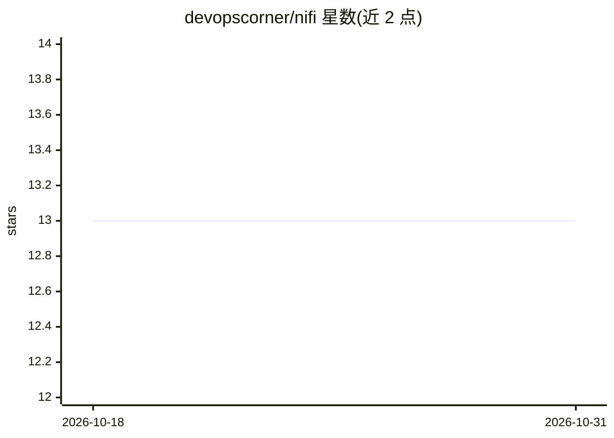

# devopscorner/nifi

⭐ 13 · Python · Apache-2.0 · 推送 2026-10-30 · [GitHub](https://github.com/devopscorner/nifi) · [官网](https://devopscorner.id) · 组织维护

**Apache NiFi 与 NiFi Registry 的生产级容器部署方案**

提供 devopscorner/nifi 与 devopscorner/nifi-registry 容器镜像（NiFi 1.18.0），内置 Python 3.10.8 及 boto3、pandas、scrapy、SQLAlchemy 等库与 Ivy 机器学习框架、Unix 常用工具。部署途径覆盖两条：虚拟机上以 Terraform + Ansible + Docker Compose 交付；Kubernetes (EKS) 上以 Helm/Helmfile 交付。Terraform 侧提供多环境工作区、S3+DynamoDB 远程状态、VPC/子网/NAT 等 AWS 基础设施编排。面向在 AWS 上运维数据流管道的团队，前置要求包括 Ansible、Docker、AWS CLI v2、Terraform。

## 筛选速览

| 维度 | 判定 | 备注 |
|---|---|---|
| AI 角色 | `ai-enhanced` | 去掉 AI 部分产品仍成立 |
| 许可风险 | `permissive` | Apache-2.0 |
| 部署形态 | `self-host` | docker 或自建部署 |
| 模型依赖 | — | README 未给出锁定关系 |
| 硬件要求 | — | 无带数字的原话,不猜 |
| 安装摩擦 | `low` | 无编译、无系统依赖或容器化 |
| 成熟度 | — | 结构信号不足 |

## 能力要点

- NiFi 与 NiFi Registry 容器镜像（1.18.0），含 Python 3.10.8 与数据/ML 相关 Python 库
- Terraform + Ansible 的 VM 部署路径与 EKS (Kubernetes) 部署路径
- Terraform 多环境工作区与 S3/DynamoDB 远程状态、VPC 等基础设施编排

## 适用场景

- 在 AWS EC2 上以 Docker Compose 运行 NiFi 数据流
- 在 EKS 集群部署 NiFi 与 NiFi Registry
- 以 Terraform 代码化管理 VPC、子网等配套基础设施

## 场景标签

 · 领域:数据工程/基础设施部署

## 证据(README 行号)

> L20: - Unified Machine Learning (ML) Framework with Ivy
> L42: - Python Libraries
> L57:  - ivy-core

## 星数曲线

2026-10-18 13 → 2026-10-31 13（+0）

---
*卡片 v1 · prompt 1.4 · 生成 2026-10-31 · 置信度 low · 依据 README sha `1f00aa493427` · [字段定义](../../DATASET.md)*
