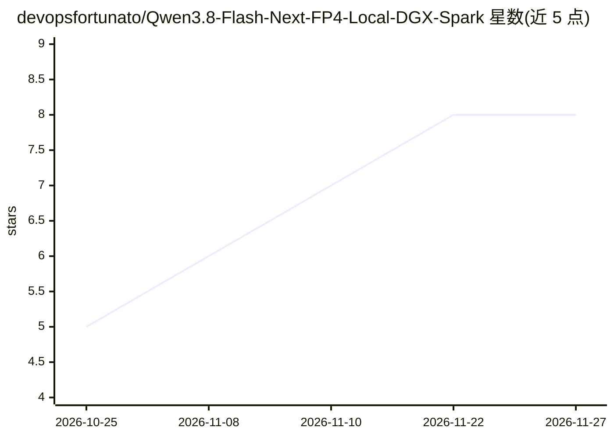

# devopsfortunato/Qwen3.8-Flash-Next-FP4-Local-DGX-Spark

⭐ 8 · Shell · MIT · 推送 2026-10-22 · [GitHub](https://github.com/devopsfortunato/Qwen3.8-Flash-Next-FP4-Local-DGX-Spark) · [官网](https://huggingface.co/nvidia/Qwen3.8-Flash-Next-FP4-Local) · 个人维护

**一条命令在 DGX Spark 上用 vLLM 服务 Qwen3.8 FP4 模型的部署脚本**

一个针对单台 NVIDIA DGX Spark（GB10）的一键部署配方：通过 git clone 获取脚本后运行 start.sh，自动拉取按 digest 固定的 eugr B12X vLLM 镜像、下载约 96 GiB 的 nvidia/Qwen3.8-Flash-Next-FP4-Local 检查点，并以 docker run 启动 vllm serve，暴露 OpenAI 兼容 API（端口 8000）。脚本内置内存/磁盘检查、flock 生命周期锁、加载监控、冒烟测试，配置集中于 scripts/config.sh，支持环境变量、.env 与 profiles/ 启动配置（含 1M 上下文与上游 vLLM v0.32 选项）。

## 筛选速览

| 维度 | 判定 | 备注 |
|---|---|---|
| AI 角色 | `ai-ecosystem` | LLM/agent 周边工具 |
| 许可风险 | `permissive` | MIT |
| 部署形态 | `self-host` | docker 或自建部署 |
| 模型依赖 | local-ok | 支持本地模型 |
| 硬件要求 | — | 无带数字的原话,不猜 |
| 安装摩擦 | `low` | 无编译、无系统依赖或容器化 |
| 成熟度 | — | 结构信号不足 |

## 能力要点

- git clone + ./start.sh 一键启动，自动完成镜像拉取、检查点下载与冒烟测试
- OpenAI 兼容 API，启用 qwen3 推理解析器与 qwen3_xml 工具调用解析器
- 可调 KV 缓存池、MTP draft token 数、YaRN 扩展等约 30 个配置项
- 提供 kv-max、1m、vllm-0.32 等可选启动 profile

## 适用场景

- 在 DGX Spark 上本地部署 Qwen3.8 FP4 模型并通过 API 调用
- 为 OpenAI 客户端提供本地推理后端
- 按内存/上下文需求切换不同的 KV 缓存与窗口配置

## 场景标签

`推理引擎` · 领域:训练与推理

## 证据(README 行号)

> L9: Serve **nvidia/Qwen3.8-Flash-Next-FP4-Local** from one NVIDIA DGX Spark through an OpenAI-compatible API.
> L96: 3. **Launch.** `docker run` with `--network host`, `--gpus all`, the model-card environment, and `vllm serve`.

## 星数曲线

2026-10-25 5 → 2026-11-27 8（+3）

---
*卡片 v1 · prompt 1.4 · 生成 2026-11-20 · 置信度 high · 依据 README sha `b313efc861af` · [字段定义](../../DATASET.md)*
