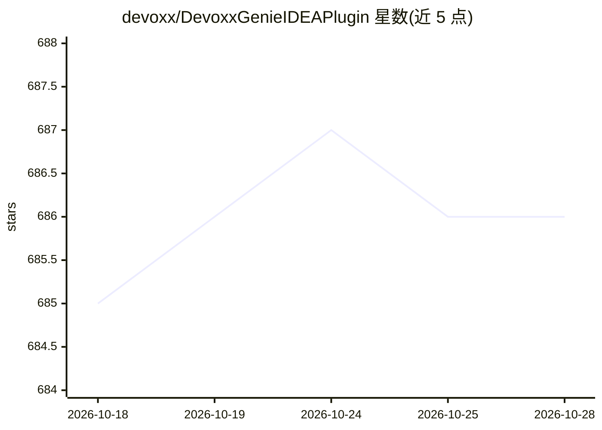

# devoxx/DevoxxGenieIDEAPlugin

⭐ 686 · Java · MIT · 推送 2026-10-28 · [GitHub](https://github.com/devoxx/DevoxxGenieIDEAPlugin) · [官网](https://genie.devoxx.com) · 组织维护

**IntelliJ IDEA 的 Java 版 LLM 代码助手插件，接入本地与云端模型**

基于 Java 的 IntelliJ IDEA 插件，作为 LLM 客户端接入本地运行时（Ollama、LMStudio、GPT4All、Llama.cpp、Nativ、Exo）与云端服务（OpenAI、Anthropic、Gemini、DeepSeek、Bedrock 等）。功能包括 Agent Mode 自主代码修改与并行子代理、Spec Driven Development（Backlog.md 任务 + Kanban + 依赖排序批量执行）、SKILL.md 技能、FIM 行内补全、RAG 上下文、Gitleaks/OpenGrep/Trivy 安全扫描、MCP 市场以及 CLI/ACP 外部代理调用。通过 JetBrains Marketplace 分发，安全扫描器为可选安装依赖。

## 筛选速览

| 维度 | 判定 | 备注 |
|---|---|---|
| AI 角色 | `ai-ecosystem` | LLM/agent 周边工具 |
| 许可风险 | `permissive` | MIT |
| 部署形态 | `None` |  |
| 模型依赖 | local-ok | 支持本地模型 |
| 硬件要求 | — | 无带数字的原话,不猜 |
| 安装摩擦 | `medium` | 含编译或系统依赖之一 |
| 成熟度 | — | 结构信号不足 |

## 能力要点

- 接入本地（Ollama/LMStudio/Llama.cpp 等）与 20 家云端 LLM 提供商
- Agent Mode 自主代码探索/修改与并行子代理
- Spec Driven Development：Backlog.md 任务 + Kanban 看板 + Agent Loop 批量执行
- Gitleaks/OpenGrep/Trivy 三种安全扫描作为 LLM 代理工具并自动建任务

## 适用场景

- 在 IDEA 内用本地或云端模型审查、解释、修改项目代码
- 以 Backlog.md 定义任务并让 Agent 批量自动实现
- 对项目做密钥泄露、SAST 与依赖 CVE 扫描并跟踪整改

## 场景标签

`编码 Agent` `代码生成` `代码审查` `RAG` · 领域:编码与开发

## 证据(README 行号)

> L8: Devoxx Genie is a fully Java-based LLM Code Assistant plugin for IntelliJ IDEA, designed to integrate with local LLM
> L137: - **🤖 Agent Mode** *(v0.9.4+)*: Autonomous code exploration and modification with built-in tools (read, write, edi

## 星数曲线

2026-10-18 685 → 2026-10-28 686（+1）

---
*卡片 v1 · prompt 1.4 · 生成 2026-10-21 · 置信度 high · 依据 README sha `07d2c00abaca` · [字段定义](../../DATASET.md)*
