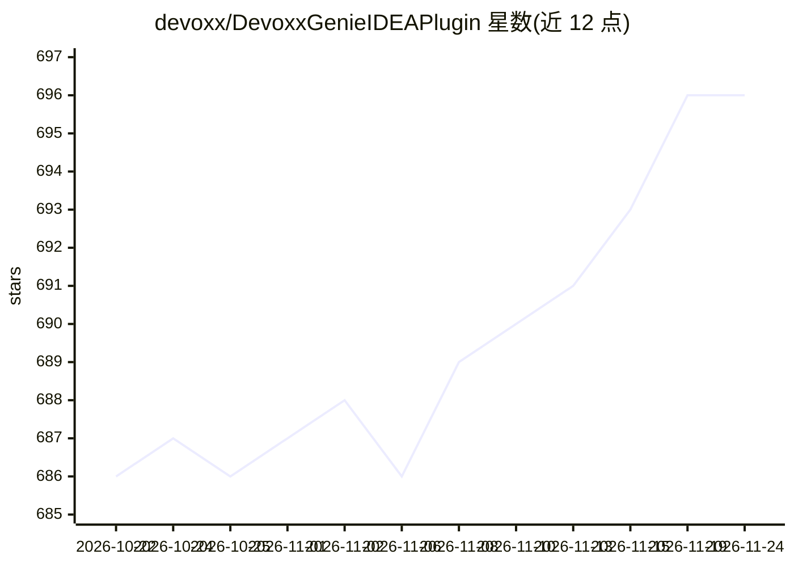

# devoxx/DevoxxGenieIDEAPlugin

⭐ 696 · Java · MIT · 推送 2026-11-22 · [GitHub](https://github.com/devoxx/DevoxxGenieIDEAPlugin) · [官网](https://genie.devoxx.com) · 组织维护

**IntelliJ IDEA 的 LLM 代码助手插件，支持本地与云端模型**

纯 Java 实现的 IntelliJ IDEA 插件，接入本地 LLM 提供方（Ollama、LMStudio、GPT4All、Llama.cpp、Nativ、Exo、Rapid-MLX）与云端提供方（OpenAI、Anthropic、Mistral、Groq、Gemini、DeepSeek 等），用于代码审查、测试与解释。机制包括 Agent Mode（读写编辑搜索文件、并行子代理）、SKILL.md 技能文件、Spec Driven Development（Backlog.md + 看板 + Agent Loop 批量执行）、MCP 市场、RAG 项目上下文、Gitleaks/OpenGrep/Trivy 安全扫描集成。通过 JetBrains Marketplace 分发。

## 筛选速览

| 维度 | 判定 | 备注 |
|---|---|---|
| AI 角色 | `ai-native` | 本体是模型或模型工具 |
| 许可风险 | `permissive` | MIT |
| 部署形态 | `None` |  |
| 模型依赖 | local-ok | 支持本地模型 |
| 硬件要求 | — | 无带数字的原话,不猜 |
| 安装摩擦 | `medium` | 含编译或系统依赖之一 |
| 成熟度 | — | 结构信号不足 |

## 能力要点

- Agent Mode 自主读写编辑搜索文件，支持并行子代理
- Spec Driven Development：Backlog.md 任务 + 看板 + Agent Loop 批量执行
- 本地 LLM 接入（Ollama/LMStudio/GPT4All/Llama.cpp/MLX）与云端多提供方接入
- MCP 服务器市场与 RAG 项目上下文

## 适用场景

- 在 IDE 内用本地模型审查和解释项目代码
- 用自然语言任务驱动 Agent 自主实现 Backlog 中的需求
- 通过 LLM 代理运行 Gitleaks/Trivy 等安全扫描并生成待办任务
- 在 Apple Silicon 设备集群上分布式运行本地模型辅助开发

## 场景标签

`代码审查` `RAG` `推理引擎` `编码 Agent` · 领域:编码与开发

## 证据(README 行号)

> L8: Devoxx Genie is a fully Java-based LLM Code Assistant plugin for IntelliJ IDEA, designed to integrate with local LLM
> L131: - **🤖 Agent Mode** *(v0.9.4+)*: Autonomous code exploration and modification with built-in tools (read, write, edi

## 星数曲线

2026-10-22 686 → 2026-11-24 696（+10）

---
*卡片 v1 · prompt 1.4 · 生成 2026-11-24 · 置信度 high · 依据 README sha `a824f5344796` · [字段定义](../../DATASET.md)*
