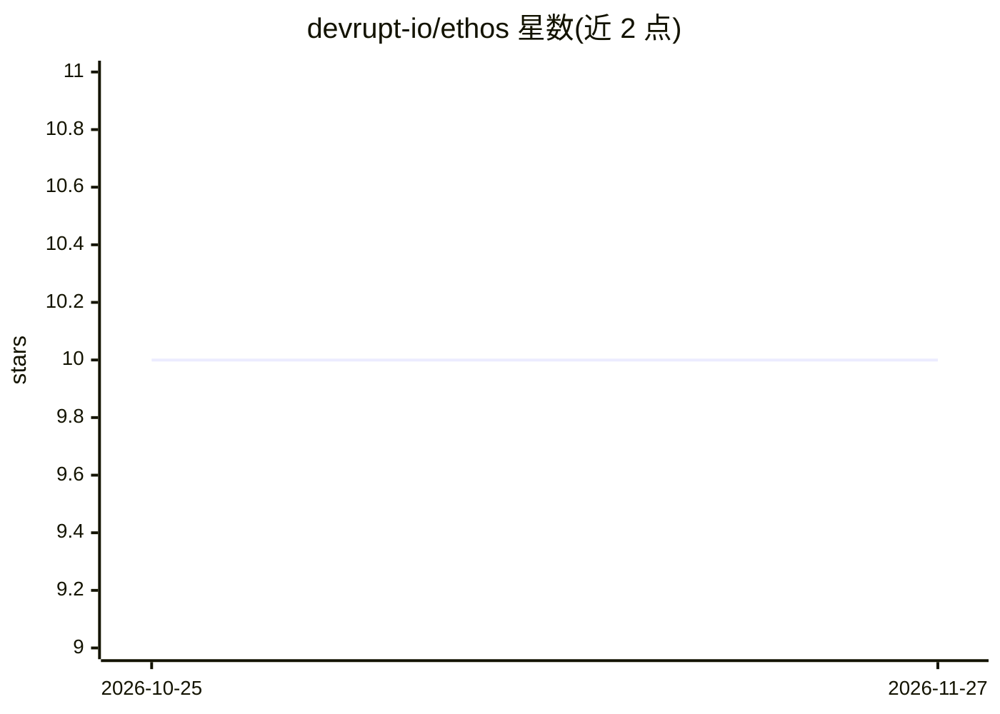

# devrupt-io/ethos

⭐ 10 · TypeScript · 推送 2026-02-17 · [GitHub](https://github.com/devrupt-io/ethos) · [官网](https://ethos.devrupt.io) · 组织维护

**分析 Hacker News 讨论、提取概念与情感的应用**

ethos 自动抓取 Hacker News 的故事与评论，通过 LLM 结构化输出提取抽象概念、实体（公司/产品/OSS 项目）与技术，生成向量嵌入存入 ChromaDB，向用户呈现趋势概念、社区情感、争论类型与语义搜索。前端 Next.js、后端 Express、持久化用 PostgreSQL，通过 Docker Compose 部署；后台 worker 自动轮询摄取，已见内容做缓存跳过以节省 API 成本。运行需配置 OpenRouter API key。

## 筛选速览

| 维度 | 判定 | 备注 |
|---|---|---|
| AI 角色 | `ai-native` | 本体是模型或模型工具 |
| 许可风险 | `permissive` | — |
| 部署形态 | `self-host` | docker 或自建部署 |
| 模型依赖 | locked-api |  |
| 硬件要求 | — | 无带数字的原话,不猜 |
| 安装摩擦 | `low` | 无编译、无系统依赖或容器化 |
| 成熟度 | — | 结构信号不足 |

## 能力要点

- 概念/实体/技术三维分析，逐项独立情感打分
- 基于 ChromaDB 的语义搜索（按概念而非关键词）
- 后台自动摄取与已见内容缓存以节省 API 成本
- 提供管理后台监控 worker 并触发重新分析

## 适用场景

- 查看 HN 社区当前在讨论哪些抽象理念与趋势
- 追踪特定公司或开源项目在 HN 上的情感倾向
- 用自然语言概念搜索相关 HN 讨论

## 场景标签

`语义搜索` · 领域:知识与检索

## 证据(README 行号)

> L7: > Explore what Hacker News is *really* thinking — concepts, sentiment, and discourse patterns extracted through LLM-
> L10: and comments, uses LLM structured output to extract deep concepts (like
> L13: specific technologies, embeds them as vectors in ChromaDB, and presents insights

## 星数曲线

2026-10-25 10 → 2026-11-27 10（+0）

---
*卡片 v1 · prompt 1.4 · 生成 2026-11-19 · 置信度 high · 依据 README sha `cea931910d91` · [字段定义](../../DATASET.md)*
