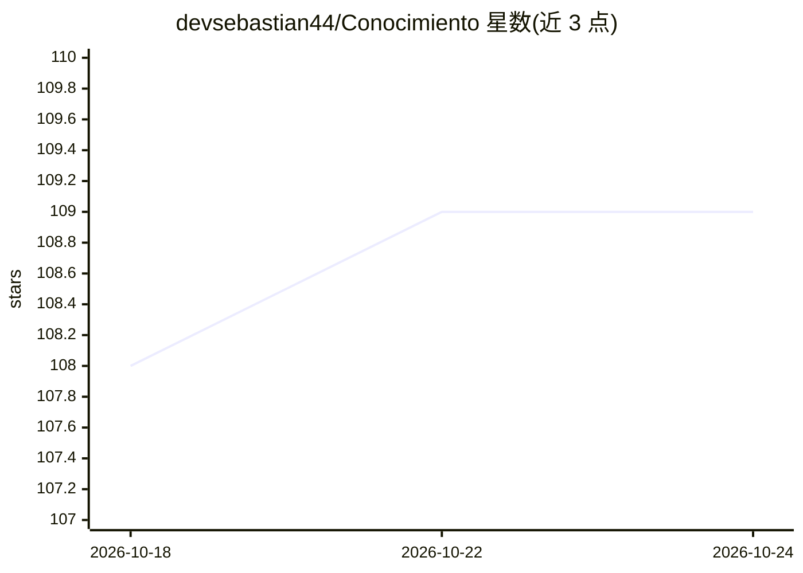

# devsebastian44/Conocimiento

⭐ 109 · NOASSERTION · 推送 2026-09-04 · [GitHub](https://github.com/devsebastian44/Conocimiento) · 个人维护

**个人自学笔记 Obsidian 库：网络安全、计算机科学与编程**

个人自学者维护的 Markdown 学习笔记仓库，设计为用 Obsidian 打开的 Vault，利用内部链接、图形可视化组织知识。内容分三大板块：网络安全（恶意软件与逆向、密码学与隐写、OSINT、渗透测试、云安全等）、计算机科学（数据库、大数据、人工智能、量子计算、操作系统、网络等）与编程（C#、Kotlin、Python、Elixir、Web、DevOps 等）。人工智能与机器学习仅为其中两个学习主题分类。可从 GitHub 直接浏览，但推荐克隆后用 Obsidian 浏览。

## 筛选速览

| 维度 | 判定 | 备注 |
|---|---|---|
| AI 角色 | `ai-knowledge` | 知识聚合/清单类 |
| 许可风险 | `none` | NOASSERTION |
| 部署形态 | `None` |  |
| 模型依赖 | — | README 未给出锁定关系 |
| 硬件要求 | — | 无带数字的原话,不猜 |
| 安装摩擦 | `low` | 无编译、无系统依赖或容器化 |
| 成熟度 | — | 结构信号不足 |

## 能力要点

- 按安全/计算机科学/编程三大板块组织的个人学习笔记库
- 设计为 Obsidian Vault，支持内部链接与图形可视化导航
- 覆盖渗透测试、密码学、大数据、AI 等 20+ 个分类主题

## 适用场景

- 查阅网络安全与渗透测试主题的自学笔记
- 参考计算机科学各领域的个人学习整理结构
- 用 Obsidian 打开浏览带链接关系的知识库

## 场景标签

`教程课程` · 领域:学习与行业

## 证据(README 行号)

> L3: Repositorio personal de estudio y documentación autodidacta. Aquí organizo todo lo que aprendo en distintas áreas co
> L41: - **06 - Inteligencia Artificial**

## 星数曲线

2026-10-18 108 → 2026-10-24 109（+1）

---
*卡片 v1 · prompt 1.4 · 生成 2026-10-23 · 置信度 mid · 依据 README sha `7e65e9943e5c` · [字段定义](../../DATASET.md)*
