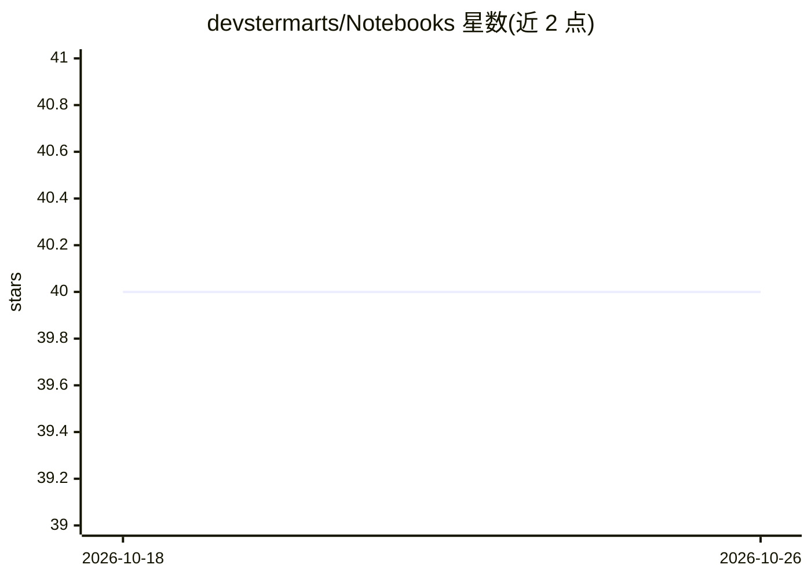

# devstermarts/Notebooks

⭐ 40 · Jupyter Notebook · 推送 2026-09-27 · [GitHub](https://github.com/devstermarts/Notebooks) · 个人维护

**在 Kaggle 上训练神经音频与隐空间扩散模型的笔记本集合**

提供一组 Jupyter 笔记本，用于在 Kaggle 平台上训练 RAVE、VSCHAOS2、MSPrior、AFTER、RAVE-Latent Diffusion、Stable Audio Tools 自编码器及 LoRA 微调等神经音频与隐空间扩散模型。使用方式为在 Kaggle 中通过 GitHub 导入笔记本，挂载自有数据集后以 GPU 会话运行；针对 Kaggle 12 小时会话上限，提供将历史输出转为数据集以续训的流程。作者声明不维护所适配的源仓库代码（RAVE-Latent Diffusion Flex'ed 除外），不提供支持。

## 筛选速览

| 维度 | 判定 | 备注 |
|---|---|---|
| AI 角色 | `ai-ecosystem` | LLM/agent 周边工具 |
| 许可风险 | `none` | — |
| 部署形态 | `None` |  |
| 模型依赖 | — | README 未给出锁定关系 |
| 硬件要求 | — | 无带数字的原话,不猜 |
| 安装摩擦 | `low` | 无编译、无系统依赖或容器化 |
| 成熟度 | — | 结构信号不足 |

## 能力要点

- 覆盖 RAVE / VSCHAOS2 / AFTER / RAVE-Latent Diffusion 等多种模型的 Kaggle 训练笔记本
- Stable Audio 3 LoRA 微调笔记本（dadabots Colab 的 Kaggle 适配）
- 跨 12 小时会话限制的断点续训流程（输出转数据集再挂载）

## 适用场景

- 在 Kaggle 免费 GPU 上训练神经音频合成模型
- 微调 Stable Audio 类生成模型
- 受限于 Colab 资源时改用 Kaggle 跑长时训练并分段续训

## 场景标签

`微调` `模型训练` · 领域:训练与推理

## 证据(README 行号)

> L3: This repo contains Jupyter notebooks for training the following neural audio and latent diffusion models on Kaggle:
> L32: Kaggle notebooks run for 12h max before terminating automatically. In case you need to run a longer training, here'

## 星数曲线

2026-10-18 40 → 2026-10-26 40（+0）

---
*卡片 v1 · prompt 1.4 · 生成 2026-10-25 · 置信度 high · 依据 README sha `f8e74182319b` · [字段定义](../../DATASET.md)*
