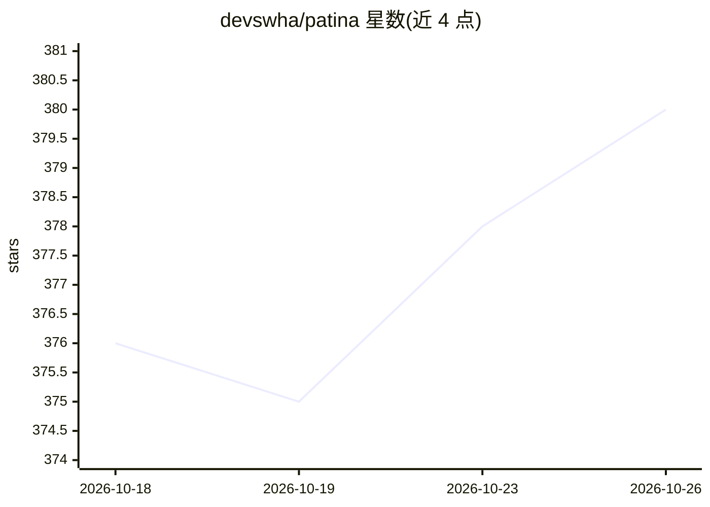

# devswha/patina

⭐ 380 · JavaScript · MIT · 推送 2026-09-29 · [GitHub](https://github.com/devswha/patina) · [官网](https://patina.vibetip.help/) · 组织维护

**面向 KO/EN/ZH/JA 的模式化文本改写工具，去除 AI 腔调**

patina 是一个基于 189 个命名模式的确定性文本改写器，覆盖韩/英/中/日四种语言，定位为允许 AI 辅助写作场景下的编辑工具（非绕过检测器）。核心机制：每处改写经 MPS/fidelity 保义门槛校验，`--diff` 可审计改动；Document Type/Persona/Register 三个独立轴分别控制文体、声音与语域。提供 agent skill（Claude Code/Codex/Cursor/OpenCode）、Node CLI（npx patina-cli）与浏览器 playground 三种使用面，可选接入 codex/claude/gemini CLI 作为后端。README 明确声明分数是编辑信号而非作者证明，并公开校准数据（67.3% 热点捕获率、16.0% 误报率）与失败案例；VS Code/Obsidian/Gmail 编辑器客户端已退役。

## 筛选速览

| 维度 | 判定 | 备注 |
|---|---|---|
| AI 角色 | `ai-enhanced` | 去掉 AI 部分产品仍成立 |
| 许可风险 | `permissive` | MIT |
| 部署形态 | `library` | 以包/库形式分发 |
| 模型依赖 | locked-api |  |
| 硬件要求 | — | 无带数字的原话,不猜 |
| 安装摩擦 | `low` | 无编译、无系统依赖或容器化 |
| 成熟度 | — | 结构信号不足 |

## 能力要点

- 189 个命名模式驱动改写，`--diff` 展示每处改动及原因
- MPS/fidelity 保义门槛，`--verify` 与 `--strict` 附加校验
- Document Type / Persona / Register 三轴独立，省略即保留原文
- agent skill、Node CLI、浏览器 playground 三种使用面；`--score --offline` 可作无 API key 的确定性 CI 门槛

## 适用场景

- 把 AI 起草的邮件或文档改写得更自然且不改变原意
- 在 Claude Code/Codex/Cursor 等 agent 中以技能形式调用改写
- CI 流水线中用确定性打分作为编辑信号门槛

## 场景标签

`AI 写作` · 领域:内容生成

## 证据(README 行号)

> L32: patina is a deterministic, pattern-based humanizer for Korean, English, Chinese, and Japanese. It finds AI-sounding
> L70: A logged-in `codex`, `claude`, or `gemini` CLI works with no API key: add `--backend codex-cli`. Full install optio

## 星数曲线

2026-10-18 376 → 2026-10-26 380（+4）

---
*卡片 v1 · prompt 1.4 · 生成 2026-10-22 · 置信度 high · 依据 README sha `5c4fb7ca47ab` · [字段定义](../../DATASET.md)*
