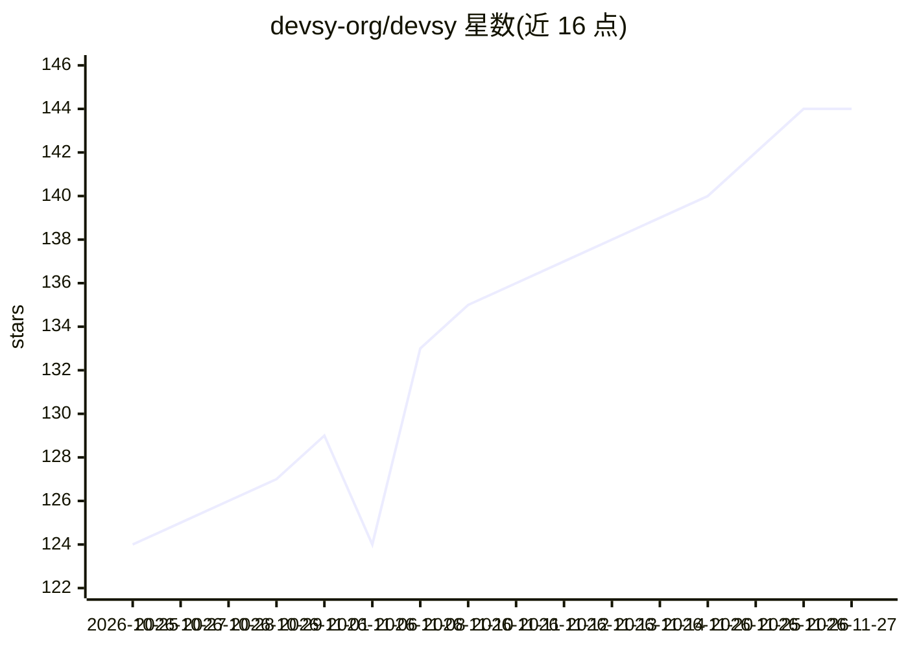

# devsy-org/devsy

⭐ 144 · Go · MPL-2.0 · 推送 2026-11-26 · [GitHub](https://github.com/devsy-org/devsy) · [官网](https://devsy.sh) · 组织维护

**为开发者与 AI 编码代理创建本地/云端隔离工作区**

Devsy 基于 DevContainer 开放标准，从同一份 devcontainer.json 定义为团队及其 AI 编码代理构建独立工作区，可运行在本地 Docker、Kubernetes、云服务商或 SSH 远程主机上。提供桌面应用与 CLI 两种形态：桌面应用管理工作区，CLI 用于自动化与平台集成。功能包括预构建、空闲自动关停、Git 与 Docker 凭据同步；每个代理工作区运行在独立容器中，可按需销毁重建，支持 VS Code 与 JetBrains。安装方式见官网文档，仓库提供多平台安装包。

## 筛选速览

| 维度 | 判定 | 备注 |
|---|---|---|
| AI 角色 | `ai-enhanced` | 去掉 AI 部分产品仍成立 |
| 许可风险 | `permissive` | MPL-2.0 |
| 部署形态 | `None` |  |
| 模型依赖 | — | README 未给出锁定关系 |
| 硬件要求 | — | 无带数字的原话,不猜 |
| 安装摩擦 | `low` | 无编译、无系统依赖或容器化 |
| 成熟度 | — | 结构信号不足 |

## 能力要点

- 基于 DevContainer 标准，工作区可跨 provider 后端移植
- 为每个 AI 编码代理运行独立容器，可按需销毁重建
- 支持本地 Docker、Kubernetes、云服务商与 SSH 远程主机
- 提供 macOS/Windows/Linux 桌面应用与多架构 CLI

## 适用场景

- 为团队的 AI 编码代理提供与开发环境一致的隔离容器
- 在本地与远程运行同一套环境定义
- 批量运行多个代理工作区并用自动关停节省资源

## 场景标签

 · 领域:开发工具/环境管理

## 证据(README 行号)

> L7: Devsy gives teams and their AI coding agents separate workspaces built from one standard definition. Workspaces run 
> L116:  Containers for agents

## 星数曲线

2026-10-25 124 → 2026-11-27 144（+20）

---
*卡片 v1 · prompt 1.4 · 生成 2026-11-27 · 置信度 mid · 依据 README sha `4fb6881e835f` · [字段定义](../../DATASET.md)*
