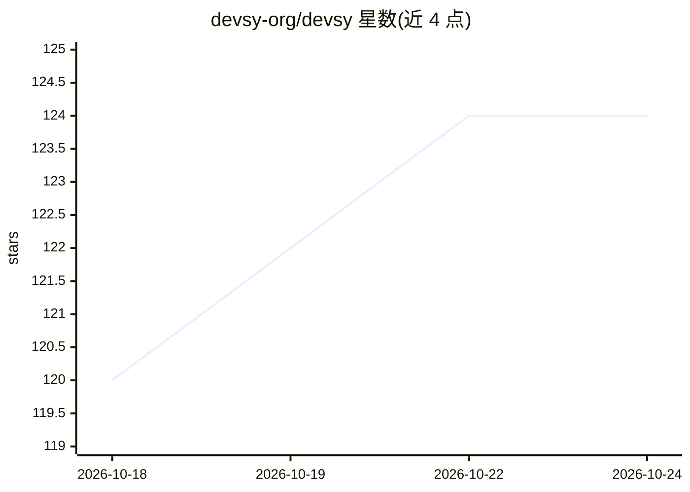

# devsy-org/devsy

⭐ 124 · Go · MPL-2.0 · 推送 2026-10-23 · [GitHub](https://github.com/devsy-org/devsy) · [官网](https://devsy.sh) · 组织维护

**为团队与 AI 编程代理部署标准化隔离开发工作区**

实现开放 DevContainer 标准的工作区管理工具，以桌面应用与 CLI 两种形式分发（macOS/Windows/Linux 多架构）。工作区可部署于 Docker、Kubernetes、云服务商与 SSH 远程主机，支持预构建、闲置自动关停、Git 与 Docker 凭据同步、跨 IDE（VS Code/JetBrains）。针对 AI 编程代理提供按 devcontainer.json 构建的一次性隔离容器，实现文件系统/网络/进程级隔离与凭据作用域控制。

## 筛选速览

| 维度 | 判定 | 备注 |
|---|---|---|
| AI 角色 | `ai-ecosystem` | LLM/agent 周边工具 |
| 许可风险 | `permissive` | MPL-2.0 |
| 部署形态 | `None` |  |
| 模型依赖 | — | README 未给出锁定关系 |
| 硬件要求 | — | 无带数字的原话,不猜 |
| 安装摩擦 | `low` | 无编译、无系统依赖或容器化 |
| 成熟度 | — | 结构信号不足 |

## 能力要点

- 实现开放 DevContainer 标准，工作区跨后端可移植
- 每个 AI 代理获得独立的隔离一次性容器
- 桌面应用与 CLI 双形态，覆盖 macOS/Windows/Linux 多架构
- 支持预构建、闲置自动关停与凭据同步

## 适用场景

- 团队统一管理本地与远程标准化开发环境
- 为 AI 编程代理提供沙箱隔离运行环境
- 在 Docker/Kubernetes/云上批量扩展代理工作区并控制成本

## 场景标签

 · 领域:开发者工具/开发环境编排

## 证据(README 行号)

> L7: Devsy enables teams and their AI coding agents to scale development using standardized, isolated workspaces. It cuts
> L94: Devsy implements the open DevContainer standard. Workspaces stay portable and repeatable across provider backends.
> L116: AI coding agents execute real commands with real access. Devsy gives each agent its own isolated, disposable conta

## 星数曲线

2026-10-18 120 → 2026-10-24 124（+4）

---
*卡片 v1 · prompt 1.4 · 生成 2026-10-23 · 置信度 high · 依据 README sha `b26076711c8a` · [字段定义](../../DATASET.md)*
