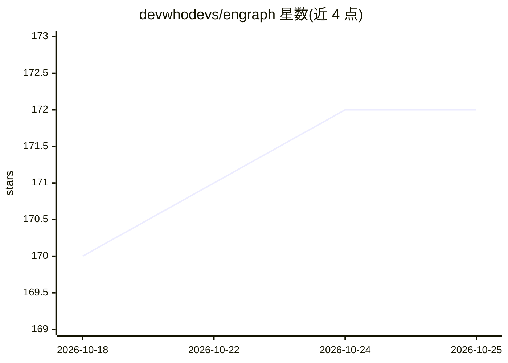

# devwhodevs/engraph

⭐ 172 · Rust · MIT · 推送 2026-05-27 · [GitHub](https://github.com/devwhodevs/engraph) · 个人维护

**把 Obsidian 库变成本地知识 API 供 AI agent 查询的 MCP 服务器**

Rust 编写的本地优先工具：将 Markdown 库索引为知识图（语义嵌入 + FTS5 + wikilink 图 + SQLite），通过 MCP 服务器（25 个工具）、HTTP REST API（26 端点）和 ChatGPT Actions 向 AI agent 提供结构化访问。搜索为 5 通道混合（语义/BM25/图扩展/重排/时间），RRF 融合；推理用 llama.cpp + GGUF 模型（必需约 300MB，可选 1.3GB），Metal GPU 加速，无 API key、无云端。另含段落级编辑、库健康诊断、PARA 迁移与文件监听实时同步。

## 筛选速览

| 维度 | 判定 | 备注 |
|---|---|---|
| AI 角色 | `ai-ecosystem` | LLM/agent 周边工具 |
| 许可风险 | `permissive` | MIT |
| 部署形态 | `library` | 以包/库形式分发 |
| 模型依赖 | local-ok | 支持本地模型 |
| 硬件要求 | — | 无带数字的原话,不猜 |
| 安装摩擦 | `high` | 编译与系统依赖俱全 |
| 成熟度 | — | 结构信号不足 |

## 能力要点

- 5 通道混合搜索（语义/BM25/图扩展/交叉编码重排/时间）RRF 融合
- MCP 服务器 25 工具 + HTTP REST API 26 端点（API key 鉴权、限流、CORS）
- llama.cpp + GGUF 本地推理，Metal GPU 加速，无 API key 无云端
- 文件监听实时同步索引与段落级编辑、frontmatter 变更

## 适用场景

- 让 Claude Code/Cursor 等 agent 直接检索和编辑我的 Obsidian 笔记
- 为 AI 助手组装 token 预算内的上下文包（主题/人物/项目）
- 通过 REST API 让网页类 agent 或脚本用 curl 查询本地笔记库
- 对笔记库做健康诊断（孤立笔记、断链、过期内容）

## 场景标签

`知识库管理` `知识图谱` `语义搜索` · 领域:知识与检索

## 证据(README 行号)

> L11: engraph turns your markdown vault into a searchable knowledge graph that any AI agent can query — Claude Code via M
> L20: - **MCP server for AI agents** — `engraph serve` exposes 25 tools (search, read, section-level editing, frontmatter
> L21: - **HTTP REST API** — `engraph serve --http` adds an axum-based HTTP server alongside MCP with 26 REST endpoints, A

## 星数曲线

2026-10-18 170 → 2026-10-25 172（+2）

---
*卡片 v1 · prompt 1.4 · 生成 2026-10-22 · 置信度 mid · 依据 README sha `65c72bbda6a5` · [字段定义](../../DATASET.md)*
