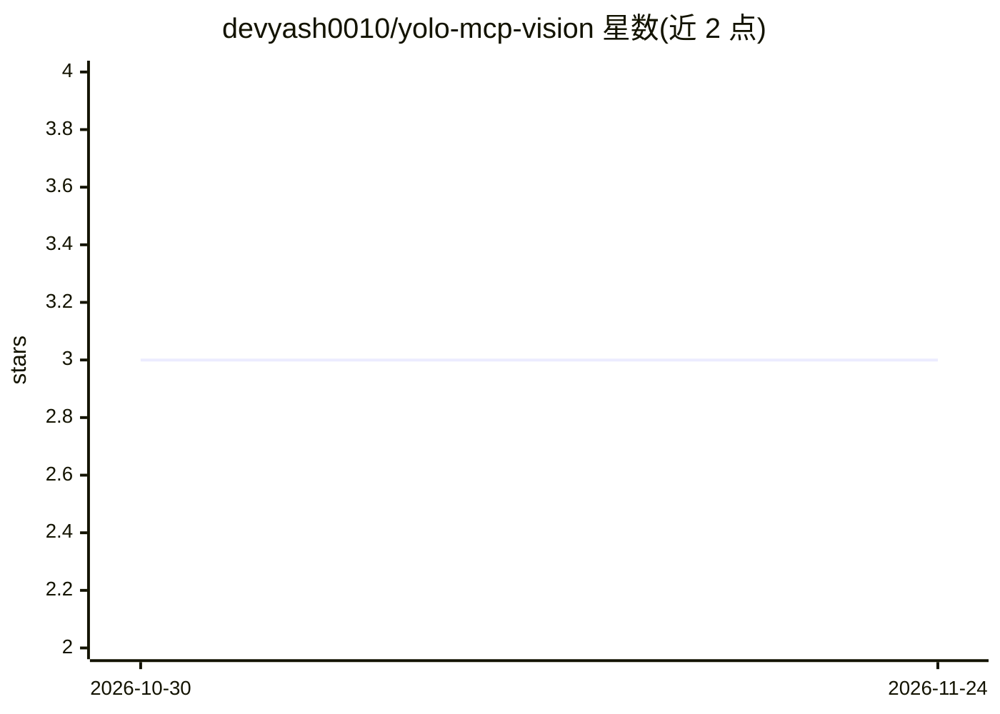

# devyash0010/yolo-mcp-vision

⭐ 3 · Python · MIT · 推送 2026-10-10 · [GitHub](https://github.com/devyash0010/yolo-mcp-vision) · 个人维护

**把 YOLO 检测结果转为结构化空间上下文供 AI agent 查询的 MCP 服务**

以 FastAPI 后端 + React 仪表盘 + 官方 Python MCP（FastMCP）服务器组成的实时视觉服务：YOLO11n 对摄像头/RTSP/图片/视频流做检测与跟踪，空间引擎据此推导 3×3 网格区域与 pairwise 2D 关系，经 12 个类型化 MCP 工具暴露给下游 agent。另含确定性查询应答器（无需 LLM/API key）、可配置的决策层、WebSocket 元数据流与 Prometheus 指标。MIT 许可，个人开发者基于周末时间构建。

## 筛选速览

| 维度 | 判定 | 备注 |
|---|---|---|
| AI 角色 | `ai-ecosystem` | LLM/agent 周边工具 |
| 许可风险 | `permissive` | MIT |
| 部署形态 | `self-host` | docker 或自建部署 |
| 模型依赖 | local-ok | 支持本地模型 |
| 硬件要求 | — | 无带数字的原话,不猜 |
| 安装摩擦 | `low` | 无编译、无系统依赖或容器化 |
| 成熟度 | — | 结构信号不足 |

## 能力要点

- 12 个类型化 MCP 工具 + 5 个只读资源，支持 Claude Desktop 配置接入
- 确定性 3×3 网格与 2D 关系（near/left_of 等）空间引擎
- 确定性查询应答器：自然语言问答无需 LLM 或 API key
- 多源输入：USB 摄像头、RTSP 流、静态图片、视频文件

## 适用场景

- 让 Claude Desktop/Cursor 等 agent 确定性查询摄像头场景
- 低带宽替代方案：向 LLM 传输结构化元数据而非原始视频帧
- 本地跑通 YOLO 检测演示与基准测试

## 场景标签

`目标检测` · 领域:感知与多模态

## 证据(README 行号)

> L3: > **Production-grade real-time computer vision service combining Ultralytics YOLO object detection with the official
> L59: The **YOLO + MCP Computer Vision System** transforms raw, pixel-level camera feeds, images, and videos into structu
> L76: 3. **The MCP Server** exposes this context through typed tools (`count_objects`, `find_object_location`, `get_scene

## 星数曲线

2026-10-30 3 → 2026-11-24 3（+0）

---
*卡片 v1 · prompt 1.4 · 生成 2026-11-22 · 置信度 high · 依据 README sha `b280c7977abf` · [字段定义](../../DATASET.md)*
