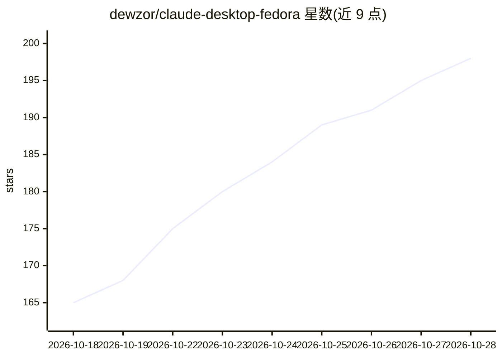

# dewzor/claude-desktop-fedora

⭐ 201 · Shell · Apache-2.0 · 推送 2026-10-22 · [GitHub](https://github.com/dewzor/claude-desktop-fedora) · [官网](https://copr.fedorainfracloud.org/coprs/dewzor/claude-desktop/) · 个人维护

**将 Claude Desktop 官方 Linux 构建重打包为 Fedora 原生 RPM**

面向 Fedora 43+/44 用户的非官方打包工程：从 Anthropic 签名的 apt 仓库下载官方 Linux x86_64 .deb，校验 GPG 指纹、SHA256 与 ELF 原生模块后，用 rpmbuild 重组为未修改上游载荷的 RPM，保留 Chromium sandbox 的 setuid 位。Claude Code 标签页、Cowork、MCP 均可用。另提供 COPR 中的 claude-desktop-builder 包（MIT 许可），经 systemd timer 每日检查并自动重建更新；不含 Claude Desktop 本体（专有软件）。限制：仅 x86_64，Flatpak 版另行提交 Flathub 审核中。

## 筛选速览

| 维度 | 判定 | 备注 |
|---|---|---|
| AI 角色 | `ai-ecosystem` | LLM/agent 周边工具 |
| 许可风险 | `permissive` | Apache-2.0 |
| 部署形态 | `desktop` | 安装包/桌面程序 |
| 模型依赖 | locked-api |  |
| 硬件要求 | — | 无带数字的原话,不猜 |
| 安装摩擦 | `low` | 无编译、无系统依赖或容器化 |
| 成熟度 | — | 结构信号不足 |

## 能力要点

- 从 Anthropic 签名 apt 仓库取官方 .deb，校验指纹/SHA256/Valid-Until 后重组为 RPM
- 上游载荷未修改，无 app.asar 补丁，Chromium sandbox 保持启用
- COPR 的 claude-desktop-builder 提供每日 systemd timer 自动更新
- Claude Code / Cowork / MCP 及 GNOME Activities 搜索均工作

## 适用场景

- 在 Fedora 44 上通过 dnf 安装并运行 Claude Desktop
- 让 Claude Desktop 在 Fedora 上自动跟进官方新版本
- 用 Flatpak 在任意发行版运行 Claude Desktop

## 场景标签

 · 领域:桌面应用打包/分发

## 证据(README 行号)

> L3: Install **Claude Desktop on Fedora 44** as a native RPM, built from Anthropic's **official Linux x86_64 build**. Unm
> L73: Anthropic publishes an official Linux build of Claude Desktop, but only as a `.deb`. The payload inside is ordinary

## 星数曲线

2026-10-18 165 → 2026-10-28 198（+33）

---
*卡片 v1 · prompt 1.4 · 生成 2026-10-22 · 置信度 high · 依据 README sha `6ebe3e0288f3` · [字段定义](../../DATASET.md)*
