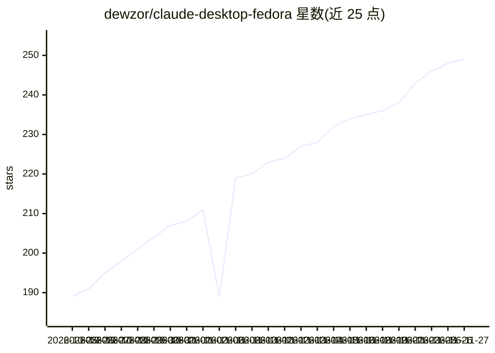

# dewzor/claude-desktop-fedora

⭐ 249 · Shell · Apache-2.0 · 推送 2026-11-22 · [GitHub](https://github.com/dewzor/claude-desktop-fedora) · [官网](https://copr.fedorainfracloud.org/coprs/dewzor/claude-desktop/) · 个人维护

**为 Fedora 用户提供 Anthropic 官方 Claude Desktop 的原生 RPM 打包与安装**

从 Anthropic 官方 Linux x86_64 构建提取载荷，重打包为 Fedora 可用的 RPM：脚本校验 apt 索引签名与 SHA256、验证原生 ELF 模块后用 rpmbuild 构建包，保持 Chromium 沙箱 setuid；另提供 COPR 包含每日 systemd 定时器实现自动重建更新。仅支持 x86_64；可选 VM 组件（qemu 等）需另行安装；遗留 Windows 重打包脚本不再维护且 Claude Code 标签页不可用。

## 筛选速览

| 维度 | 判定 | 备注 |
|---|---|---|
| AI 角色 | `ai-ecosystem` | LLM/agent 周边工具 |
| 许可风险 | `permissive` | Apache-2.0 |
| 部署形态 | `desktop` | 安装包/桌面程序 |
| 模型依赖 | locked-api |  |
| 硬件要求 | — | 无带数字的原话,不猜 |
| 安装摩擦 | `low` | 无编译、无系统依赖或容器化 |
| 成熟度 | — | 结构信号不足 |

## 能力要点

- 从 Anthropic 官方签名 apt 仓库校验签名与 SHA256 后重打包为 RPM
- 保留 Chromium 沙箱（chrome-sandbox setuid 4755，不使用 --no-sandbox）
- COPR 包提供每日自动检测并重建更新的 systemd timer
- MCP、Claude Code 集成终端与 Cowork 在 Fedora 44 上可运行

## 适用场景

- 在 Fedora 44/43 KDE 或 GNOME 上以原生 RPM 方式安装 Claude Desktop
- 通过 dnf 与 COPR 定时器自动获取最新版 Claude Desktop
- 在 Linux 桌面配置并运行 MCP 服务器

## 场景标签

 · 领域:系统工具/软件打包分发

## 证据(README 行号)

> L3: Install **Claude Desktop on Fedora 44** as a native RPM, built from Anthropic's **official Linux x86_64 build**. Unm
> L31: `claude-desktop-builder` is a small MIT-licensed package. It does not contain Claude Desktop, and it never will. Cl
> L73: `build-official.sh`:

## 星数曲线

2026-10-25 189 → 2026-11-27 249（+60）

---
*卡片 v1 · prompt 1.4 · 生成 2026-11-25 · 置信度 high · 依据 README sha `fa4b336a55f0` · [字段定义](../../DATASET.md)*
