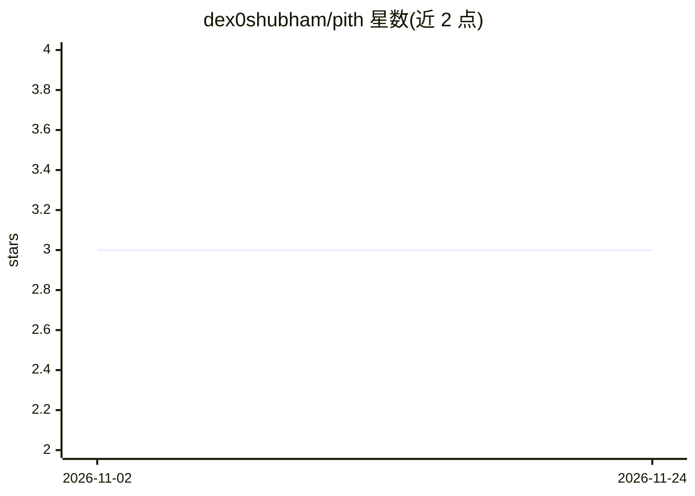

# dex0shubham/pith

⭐ 3 · Python · MIT · 推送 2026-10-14 · [GitHub](https://github.com/dex0shubham/pith) · [官网](https://pypi.org/project/pith-optimizer/) · 个人维护

**为 LLM 流量做输出 token 省用验证的代理与插件工具**

pith 是一个面向 LLM 路由的输出 token 开销优化工具：按 provider/model/system prompt 将请求分组为路由，采样记录到 SQLite，对每个候选 profile 重放样本请求，由 judge 模型逐对与基线比较，仅当达到基线自一致性地板且节省能在一月内摊销 sweep 成本时才固定该 profile，否则拒绝并给出理由。提供独立代理（pith serve）及 LiteLLM/Headroom/Portkey 插件四种接入方式，支持 kill switch 与按路由禁用。MIT 许可。

## 筛选速览

| 维度 | 判定 | 备注 |
|---|---|---|
| AI 角色 | `ai-ecosystem` | LLM/agent 周边工具 |
| 许可风险 | `permissive` | MIT |
| 部署形态 | `library` | 以包/库形式分发 |
| 模型依赖 | locked-api |  |
| 硬件要求 | — | 无带数字的原话,不猜 |
| 安装摩擦 | `low` | 无编译、无系统依赖或容器化 |
| 成熟度 | — | 结构信号不足 |

## 能力要点

- judge 模型逐对比较候选与基线，并以基线自一致性为地板判定
- 仅在达到地板且 sweep 成本可回收时固定 profile，否则拒绝
- 四种接入方式：独立代理与 LiteLLM/Headroom/Portkey 插件
- 提供 X-Optimizer 逐请求关闭、逐路由禁用与全局环境变量开关

## 适用场景

- 为高频 LLM 路由验证并套用更省 token 的输出配置
- 在 LiteLLM 代理后以 guardrail 方式接入优化
- 固定 profile 后定期重判线上流量并在漂移时回退

## 场景标签

`模型网关` · 领域:Agent 开发

## 证据(README 行号)

> L6: Cut LLM output-token spend without losing information. pith watches a route, replays a sample under cheaper
> L73: 1. **Fingerprint.** Requests are grouped into routes by provider, model and system prompt.
> L90: ||Standalone proxy|LiteLLM|Headroom|Portkey|

## 星数曲线

2026-11-02 3 → 2026-11-24 3（+0）

---
*卡片 v1 · prompt 1.4 · 生成 2026-11-22 · 置信度 high · 依据 README sha `d3074153946d` · [字段定义](../../DATASET.md)*
