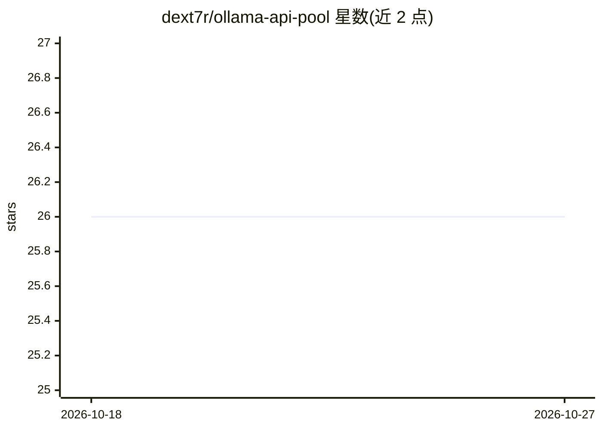

# dext7r/ollama-api-pool

⭐ 26 · JavaScript · MIT · 推送 2026-01-21 · [GitHub](https://github.com/dext7r/ollama-api-pool) · [官网](https://ollama-api-pool.h7ml.workers.dev) · 个人维护 · 中文 README

**给开发者的 Ollama/OpenRouter API 代理池，多 Key 轮询与故障转移**

部署在 Cloudflare Workers 上的 API 代理池，接入 Ollama 与 OpenRouter 两种上游 Provider，对外统一暴露 OpenAI 兼容接口。核心机制：多 API Key 轮询（Round-robin）、连续失败 3 次自动禁用 1 小时并自动恢复、单请求最多重试 3 次、统一客户端 Token 鉴权保护上游 Key。提供 Web 管理后台（批量导入、健康检查、使用统计）、用户系统（邮箱注册、每日签到延长凭证、Turnstile 验证），存储支持 PostgreSQL/Redis/KV 混合架构。安装流程为 pnpm install 后经 wrangler 部署到 Cloudflare Workers，需 Node.js >= 20。

## 筛选速览

| 维度 | 判定 | 备注 |
|---|---|---|
| AI 角色 | `ai-ecosystem` | LLM/agent 周边工具 |
| 许可风险 | `permissive` | MIT |
| 部署形态 | `library` | 以包/库形式分发 |
| 模型依赖 | local-ok | 支持本地模型 |
| 硬件要求 | — | 无带数字的原话,不猜 |
| 安装摩擦 | `low` | 无编译、无系统依赖或容器化 |
| 成熟度 | — | 结构信号不足 |

## 能力要点

- 多 Provider（Ollama/OpenRouter）统一 OpenAI 兼容接口，可按路径智能路由
- 多 Key 轮询、自动禁用/恢复与批量健康检查
- Web 管理后台与用户系统（邮箱注册、签到续期、Turnstile）
- 多层存储可选 PostgreSQL（Supabase）+ Redis（Upstash）+ Cloudflare KV

## 适用场景

- 我有多个 Ollama/OpenRouter 账号，想聚合成一个统一入口做负载均衡
- 上游 Key 经常失效，需要自动故障转移和健康检查
- 给不同用户分发独立客户端 Token 并统计各自用量

## 场景标签

`模型网关` · 领域:Agent 开发

## 证据(README 行号)

> L33: 基于 Cloudflare Workers 的智能 Ollama/OpenRouter API 代理池，支持多 Provider、多账号轮询、自动故障转移和统一鉴权。
> L44: - 🔌 **统一接口** - 所有 Provider 使用相同的 OpenAI 兼容接口

## 星数曲线

2026-10-18 26 → 2026-10-27 26（+0）

---
*卡片 v1 · prompt 1.4 · 生成 2026-10-26 · 置信度 mid · 依据 README sha `b14eb25c77f9` · [字段定义](../../DATASET.md)*
