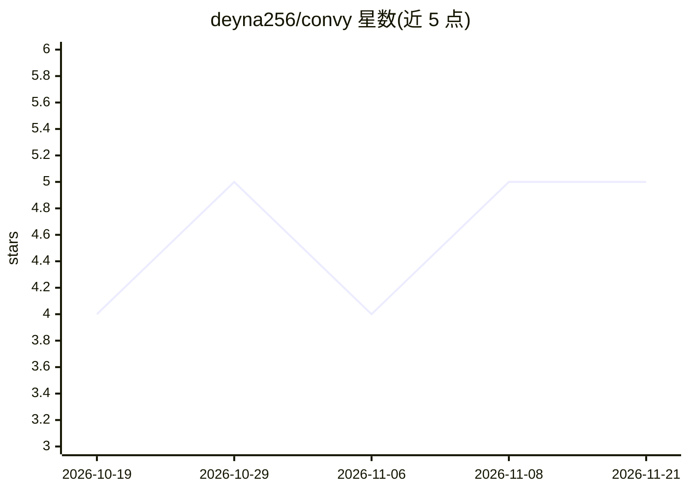

# deyna256/convy

⭐ 5 · Python · MIT · 推送 2026-11-01 · [GitHub](https://github.com/deyna256/convy) · [官网](https://deyna256.github.io/convy/) · 个人维护

**面向 AI agent 的对话测试 CLI：模拟用户对话并逐条判定**

convy 是一个测试 AI agent 对话能力的 CLI 与 Python 库：模拟用户通过 agent 的 JSON API 发起多轮对话，用户会提出模糊问题、中途改变需求、延迟给出细节；judge（由模型担任）对对话的每条自然语言声明单独判定并说明理由。报告给出重复尝试的通过率、agent 的 token 消耗与响应时间，并支持对比两个构建的差异页面。场景以 YAML 编写，agent 只需 JSON API 配置或两个小类接入，无需其代码或模型；共四个依赖，无平台、账户或容器。当前为 alpha 阶段，API 与运行格式可能变化。

## 筛选速览

| 维度 | 判定 | 备注 |
|---|---|---|
| AI 角色 | `ai-ecosystem` | LLM/agent 周边工具 |
| 许可风险 | `permissive` | MIT |
| 部署形态 | `library` | 以包/库形式分发 |
| 模型依赖 | — | README 未给出锁定关系 |
| 硬件要求 | — | 无带数字的原话,不猜 |
| 安装摩擦 | `low` | 无编译、无系统依赖或容器化 |
| 成熟度 | `idea` | |

## 能力要点

- 模拟用户多轮对话 + judge 逐条声明判定并说明理由
- 输出通过率、token 消耗、响应时间及两构建对比页
- 任意 API 后面的 agent 皆可接入，无需其代码或模型
- 四个依赖，无平台/账户/容器，报告为本地 HTML 文件

## 适用场景

- 改了 prompt、模型或工具后回归测试 agent 对话行为
- 对比新旧构建，区分真实退化与噪声波动
- 在 CI 中对运行中的 agent 做对话级测试

## 场景标签

`模型评测` · 领域:评测与运维

## 证据(README 行号)

> L26: You change a prompt, a model or a tool. Does the agent still behave in a real conversation? convy
> L122: convy does one job. It checks a running agent through its API, with scenarios in YAML, repeated

## 星数曲线

2026-10-19 4 → 2026-11-21 5（+1）

---
*卡片 v1 · prompt 1.4 · 生成 2026-11-21 · 置信度 high · 依据 README sha `45873066eee7` · [字段定义](../../DATASET.md)*
