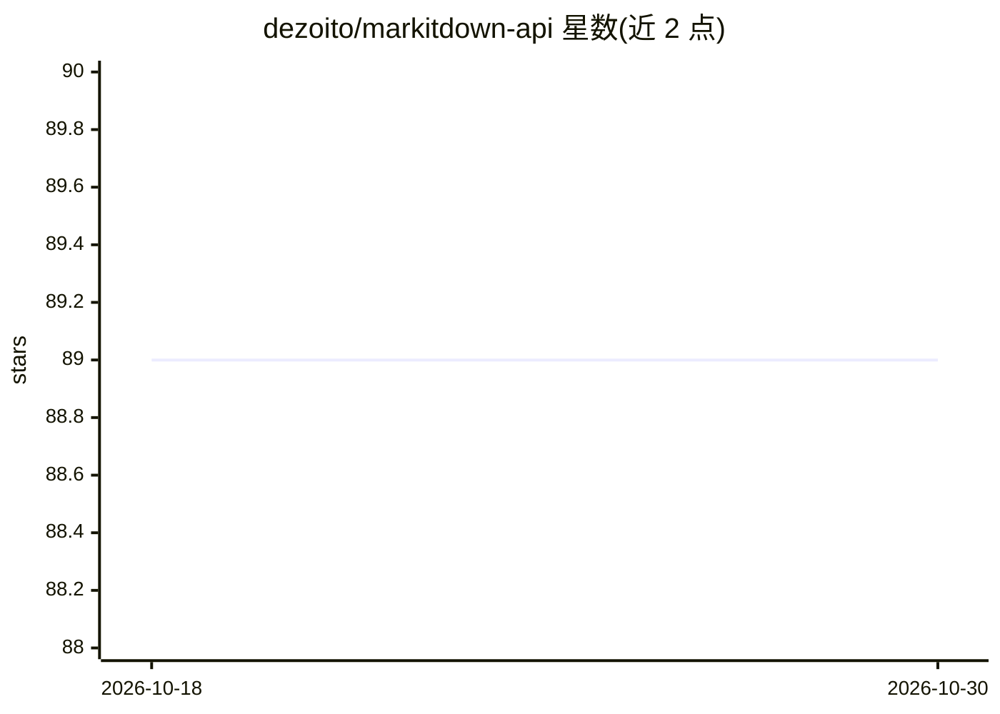

# dezoito/markitdown-api

⭐ 89 · Python · MIT · 推送 2026-07-22 · [GitHub](https://github.com/dezoito/markitdown-api) · 个人维护

**将 Office/PDF 等文件转为 Markdown 的轻量 REST API 服务**

基于 FastAPI 的 REST 服务，接收上传的二进制文件（doc/docx/ppt/pptx/pdf/xls/xlsx/txt/csv/json），调用 MarkItDown 库转换为 Markdown 并以 JSON 返回。提供 /process_file 端点与 /docs 交互式文档界面。项目始于 elbruno/MarkItDownServer 的 fork，使用 uv 管理依赖与多阶段 Docker 构建。安装方式为拉取 GHCR 预构建镜像或本地构建镜像运行，适合作为文档预处理步骤接入 RAG/LLM 流水线。

## 筛选速览

| 维度 | 判定 | 备注 |
|---|---|---|
| AI 角色 | `ai-ecosystem` | LLM/agent 周边工具 |
| 许可风险 | `permissive` | MIT |
| 部署形态 | `self-host` | docker 或自建部署 |
| 模型依赖 | — | README 未给出锁定关系 |
| 硬件要求 | — | 无带数字的原话,不猜 |
| 安装摩擦 | `low` | 无编译、无系统依赖或容器化 |
| 成熟度 | — | 结构信号不足 |

## 能力要点

- POST /process_file 接收二进制文件并返回 Markdown JSON
- 支持 doc/docx/ppt/pptx/pdf/xls/xlsx/txt/csv/json 共 10 种文件类型
- 提供 GHCR 预构建 Docker 镜像（端口 8490）
- 使用 uv 依赖管理与多阶段 Docker 构建

## 适用场景

- 为 RAG 流水线批量把文档转成 Markdown
- 通过 REST 接口向本地 LLM 应用投喂格式化文档
- 文档预处理服务的快速容器化部署

## 场景标签

`文档解析` · 领域:知识与检索

## 证据(README 行号)

> L3: This project is a lightweight REST API server built using FastAPI that receives binary data from a file, converts it
> L92: - **Accepted file types**: doc, docx, ppt, pptx, pdf, xls, xlsx, txt, csv, json

## 星数曲线

2026-10-18 89 → 2026-10-30 89（+0）

---
*卡片 v1 · prompt 1.4 · 生成 2026-10-23 · 置信度 high · 依据 README sha `52c47dcd6da4` · [字段定义](../../DATASET.md)*
