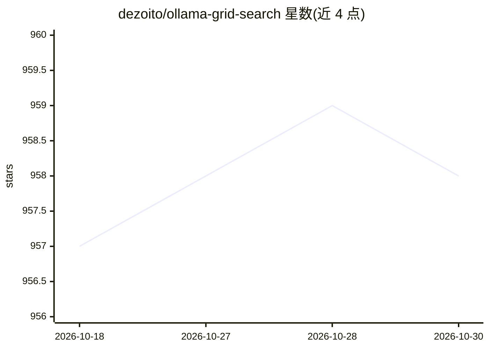

# dezoito/ollama-grid-search

⭐ 958 · TypeScript · MIT · 推送 2026-09-07 · [GitHub](https://github.com/dezoito/ollama-grid-search) · 个人维护

**桌面应用：批量评测与 A/B 对比 Ollama 本地模型和提示词**

用 Rust 和 React 编写的多平台桌面应用，面向已安装 Ollama 的用户：自动从本地或远程 Ollama 服务器拉取模型列表，对模型、提示词与推理参数的多种组合进行迭代推理并可视化检视结果。支持 A/B 测试、多轮迭代、并发或同步调用、记录推理时间与 tokens 等元数据，实验可列表查看、下载 JSON、克隆重跑；内置提示词库并支持 Open WebUI 式的 "/" 自动补全。提供 macOS/Windows/Linux 安装包，Apple Silicon 版采用 ad-hoc 签名需手动放行；兼容 llmman 等提供 Ollama API 的本地运行器。

## 筛选速览

| 维度 | 判定 | 备注 |
|---|---|---|
| AI 角色 | `ai-ecosystem` | LLM/agent 周边工具 |
| 许可风险 | `permissive` | MIT |
| 部署形态 | `desktop` | 安装包/桌面程序 |
| 模型依赖 | local-ok | 支持本地模型 |
| 硬件要求 | — | 无带数字的原话,不猜 |
| 安装摩擦 | `low` | 无编译、无系统依赖或容器化 |
| 成熟度 | — | 结构信号不足 |

## 能力要点

- 迭代模型×提示词×参数组合并可视化检视推理结果
- A/B 测试与多次迭代，输出推理时间/tokens/tokens-s 元数据
- 实验可列表、JSON 下载、克隆修改后重跑
- 提示词库管理，"/" 自动补全（计划兼容 Open WebUI 格式）

## 适用场景

- 在本地多个 Ollama 模型间挑选适合任务的一个
- 对比不同提示词或参数组合在同一模型上的输出
- 留存并导出实验记录供复盘

## 场景标签

`模型评测` `提示工程` · 领域:Agent 开发

## 证据(README 行号)

> L3: This project automates the process of selecting the best models, prompts, or inference parameters for a given use-ca
> L42: - Iterates over multiple different models, prompts and parameters to generate inferences;

## 星数曲线

2026-10-18 957 → 2026-10-30 958（+1）

---
*卡片 v1 · prompt 1.4 · 生成 2026-10-21 · 置信度 high · 依据 README sha `55ddfdc78366` · [字段定义](../../DATASET.md)*
