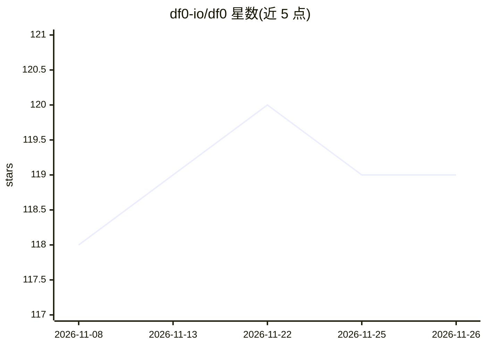

# df0-io/df0

⭐ 119 · C++ · NOASSERTION · 推送 2026-11-15 · [GitHub](https://github.com/df0-io/df0) · [官网](https://df0.io) · 组织维护

**给 C++ 开发者的本地优先数据处理 SDK：构建确定性管道**

DF-0 是可嵌入的 C++20 数据处理 SDK，以 operator| 组合管道，覆盖文件/邮件/归档/图像(OCR)等 100+ 格式的摄取、解析、格式检测、结构化导出，并支持过滤、分类、实体抽取、情感分析、本地文本嵌入等转换步骤，可接入本地 AI（llama.cpp 集成、IBM Granite 1B 模型）与显式云 AI（OpenAI）步骤。默认本地运行，提供注入式审计机制与确定性执行；部分能力（语义分区、数据库连接器等）标注为规划中。以源码编译方式集成到用户自己的应用。

## 筛选速览

| 维度 | 判定 | 备注 |
|---|---|---|
| AI 角色 | `ai-ecosystem` | LLM/agent 周边工具 |
| 许可风险 | `none` | NOASSERTION |
| 部署形态 | `None` |  |
| 模型依赖 | local-ok | 支持本地模型 |
| 硬件要求 | — | 无带数字的原话,不猜 |
| 安装摩擦 | `medium` | 含编译或系统依赖之一 |
| 成熟度 | — | 结构信号不足 |

## 能力要点

- operator| 组合的可嵌入 C++20 数据管道
- 100+ 输入格式解析与基于文件签名/内容分析的格式检测
- 本地 OCR（100+ 语言）、本地文档 AI、本地文本嵌入可离线运行
- 可选 llama.cpp 集成（local-ai-llama）与 IBM Granite 4.0 1B 模型（local-ai-model-granite）

## 适用场景

- 把脏 PDF、邮件归档、OCR 扫描等非结构化输入规范化为可嵌入/分块的文档元素
- 构建默认不出内网、带审计输出的合规数据处理管道
- 为 RAG / 语义搜索 / 数据集准备生成清洁的结构化输入

## 场景标签

`OCR` `文档解析` · 领域:知识与检索

## 证据(README 行号)

> L9: DF-0 is an embeddable software development kit (SDK): a set of reusable C++ building blocks for building data-proces
> L17: - **Transform** data with filters, translations, summaries, classification, entity extraction, sentiment analysis, 
> L81: **The layer your AI pipeline is missing:** Raw documents are rarely LLM-ready. Dirty PDFs, malformed email archives

## 星数曲线

2026-11-08 118 → 2026-11-26 119（+1）

---
*卡片 v1 · prompt 1.4 · 生成 2026-11-17 · 置信度 high · 依据 README sha `34f6084b2cc4` · [字段定义](../../DATASET.md)*
