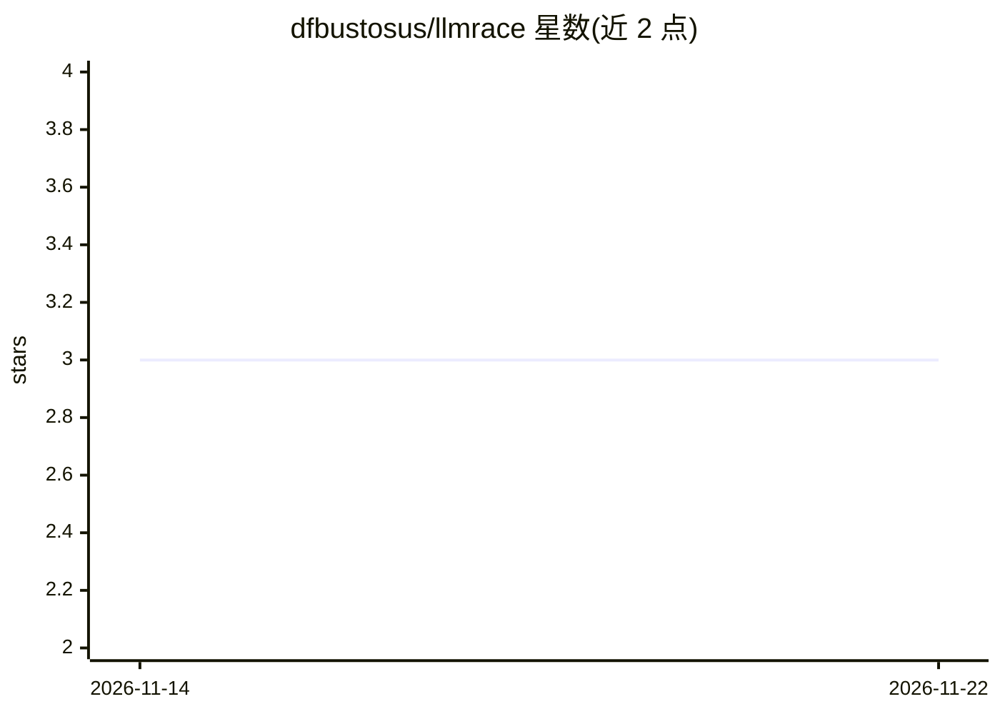

# dfbustosus/llmrace

⭐ 3 · Rust · Apache-2.0 · 推送 2026-11-21 · [GitHub](https://github.com/dfbustosus/llmrace) · [官网](https://github.com/dfbustosus/llmrace#readme) · 个人维护

**在终端对多个 LLM 提供商做并发延迟基准竞速的 Rust CLI**

llmrace 是一个 Rust 编写的命令行基准工具：对多个 LLM 提供商同时发出相同的流式请求，实时显示 token 到达过程，测量 TTFB/TTFT、TPOT、tokens/s、ITL 分布、p50/p95 延迟与每次运行成本，并输出 markdown/JSON/CSV/HTML 报告。提供 Welch t 检验显著性判定、goodput 排名、--baseline 回归门禁、--recommend 性价比推荐与 --doctor 诊断。分发形式包括 Homebrew、cargo、预编译二进制、Docker 镜像与 GitHub Action；支持 20+ 云提供商及 Ollama/LM Studio/llama.cpp 本地后端。Bedrock 与 Vertex 路径标注为实验性，作者声明未用真实云账号验证。

## 筛选速览

| 维度 | 判定 | 备注 |
|---|---|---|
| AI 角色 | `ai-ecosystem` | LLM/agent 周边工具 |
| 许可风险 | `permissive` | Apache-2.0 |
| 部署形态 | `desktop` | 安装包/桌面程序 |
| 模型依赖 | local-ok | 支持本地模型 |
| 硬件要求 | — | 无带数字的原话,不猜 |
| 安装摩擦 | `low` | 无编译、无系统依赖或容器化 |
| 成熟度 | — | 结构信号不足 |

## 能力要点

- 同一请求并发竞速多个提供商，测量 TTFB、tokens/s、p95 延迟与成本
- 20+ 提供商通过环境变量自动检测，含 Ollama/LM Studio/llama.cpp 本地后端
- Welch t 检验显著性判定与 goodput（tokens/s × 成功率）排名
- 输出 markdown/JSON/CSV/HTML 报告，支持 --baseline 回归门禁与 GitHub Action 集成

## 适用场景

- 比较不同 LLM 提供商在我所在地区的真实延迟与流式吞吐
- 为 CI 流水线设置模型延迟/质量回归基线
- 在选型时评估各提供商的性价比（--recommend）
- 把本地 Ollama 模型与云端 API 放在同一场竞速中对比

## 场景标签

`模型评测` · 领域:评测与运维

## 证据(README 行号)

> L18: Every LLM provider claims to be "fast". **TTFB, streaming throughput and p95 tail latency tell a different story** 
> L109: Every provider with a matching env var races automatically — no config file:

## 星数曲线

2026-11-14 3 → 2026-11-22 3（+0）

---
*卡片 v1 · prompt 1.4 · 生成 2026-11-22 · 置信度 high · 依据 README sha `5728c239893f` · [字段定义](../../DATASET.md)*
