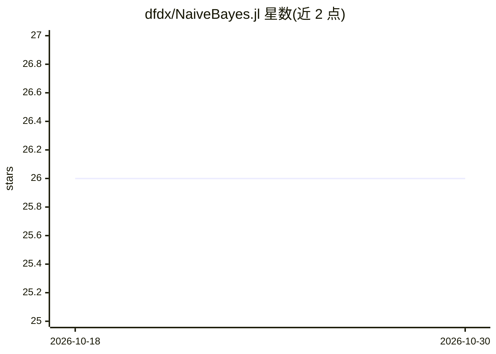

# dfdx/NaiveBayes.jl

⭐ 26 · Julia · MIT · 推送 2026-02-06 · [GitHub](https://github.com/dfdx/NaiveBayes.jl) · 个人维护

**Julia 朴素贝叶斯分类器库（三种 NB 模型）**

Julia 语言的朴素贝叶斯分类器包，提供 MultinomialNB（文本分类）、GaussianNB（连续数据，多变量正态分布）与 HybridNB（连续+离散混合特征，连续部分用核密度估计）三种模型。fit/predict 接口以 Dict{Symbol, Vector} 为主，全连续特征时支持 Matrix 输入；附带 DataStats 类型做均值、协方差等统计量的增量计算。HybridNB 模型可写入/读取 HDF5 文件以便跨程序复用。README 顶部明确声明：包创建多年未现代化，仅支持具体类型，API 不一致，MLJ.jl 对其做了包装以修复部分问题。

## 筛选速览

| 维度 | 判定 | 备注 |
|---|---|---|
| AI 角色 | `ai-native` | 本体是模型或模型工具 |
| 许可风险 | `permissive` | MIT |
| 部署形态 | `None` |  |
| 模型依赖 | — | README 未给出锁定关系 |
| 硬件要求 | — | 无带数字的原话,不猜 |
| 安装摩擦 | `low` | 无编译、无系统依赖或容器化 |
| 成熟度 | — | 结构信号不足 |

## 能力要点

- 三种朴素贝叶斯模型：MultinomialNB / GaussianNB / HybridNB
- HybridNB 用核密度估计处理连续特征，支持混合特征
- DataStats 类型支持均值/协方差等统计量增量计算
- HybridNB 模型可写入/读取 HDF5 文件

## 适用场景

- 在 Julia 中做文本分类（MultinomialNB）
- 对连续或连续+离散混合数据做分类预测
- 训练一次模型保存为 HDF5，在集群上并行预测

## 场景标签

 · 领域:机器学习/分类

## 证据(README 行号)

> L12: Naive Bayes classifier. Currently 3 types of NB are supported:
> L14:  * **MultinomialNB** - Assumes variables have a multinomial distribution. Good for text classification. See `exampl

## 星数曲线

2026-10-18 26 → 2026-10-30 26（+0）

---
*卡片 v1 · prompt 1.4 · 生成 2026-10-27 · 置信度 high · 依据 README sha `113f00fc5287` · [字段定义](../../DATASET.md)*
