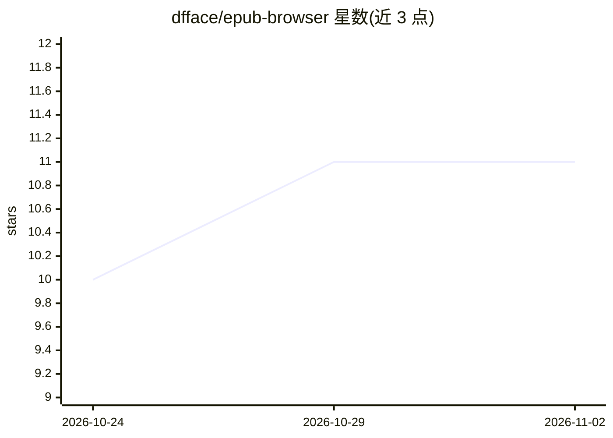

# dfface/epub-browser

⭐ 11 · Python · MIT · 推送 2026-10-31 · [GitHub](https://github.com/dfface/epub-browser) · [官网](https://epub-browser-test.yuhan.tech) · 个人维护 · 中文 README

**可自托管的 EPUB/PDF 网页图书馆，支持静态站与多用户服务模式**

基于 Python（Starlette/Uvicorn）的电子书阅读与图书馆应用，接受 .epub 与 .pdf，PDF 每页作为阅读器章节由 PDF.js 本地渲染。提供两种部署：ssg 生成静态站点（进度存浏览器），server 模式提供账号、权限、OIDC 单点登录、批注同步与阅读统计。Server 模式可选接入 OpenAI 兼容 API，为 EPUB 提供章节导读、证据链接解释、思维导图与私有 Ask AI（PDF 不含 AI；SSG 模式无 AI 配置）。另有面向旧款 Kindle 的极简模式。通过 pip 或 Docker 安装。

## 筛选速览

| 维度 | 判定 | 备注 |
|---|---|---|
| AI 角色 | `ai-enhanced` | 去掉 AI 部分产品仍成立 |
| 许可风险 | `permissive` | MIT |
| 部署形态 | `self-host` | docker 或自建部署 |
| 模型依赖 | — | README 未给出锁定关系 |
| 硬件要求 | — | 无带数字的原话,不猜 |
| 安装摩擦 | `low` | 无编译、无系统依赖或容器化 |
| 成熟度 | — | 结构信号不足 |

## 能力要点

- EPUB 与 PDF 统一的阅读器体验（PDF 由 PDF.js 本地逐页渲染）
- ssg 静态站 / server 多用户两种部署模式，同一代码库
- Server 模式：账号、书籍权限、OIDC SSO、批注同步、阅读统计、OpenAPI 与 WebHooks
- Server 模式可选 OpenAI 兼容 API 的 AI 阅读（章节导读/Ask AI），受书籍权限管控
- Kindle 极简模式（--kindle）：无依赖、e-ink 友好、ES5 兼容

## 适用场景

- 搭建私有家庭/团队电子书图书馆并跨设备同步阅读进度与批注
- 把 EPUB/PDF 藏书发布为纯静态站点离线阅读
- 在旧款 Kindle 等受限设备上阅读自己的书库
- 阅读时在原文旁获得 AI 章节导读并向 AI 提问（Server 模式）

## 场景标签

`文档问答` · 领域:知识与检索

## 证据(README 行号)

> L36: - **AI-native reading, grounded in the text:** In Server mode, chapter guides,
> L105: |AI reading and Ask AI|Not included|Available for EPUB when configured and explicitly permitted; hidden for PDF|
> L116: ### AI-native reading (Server only)

## 星数曲线

2026-10-24 10 → 2026-11-02 11（+1）

---
*卡片 v1 · prompt 1.4 · 生成 2026-11-02 · 置信度 high · 依据 README sha `547f664d081c` · [字段定义](../../DATASET.md)*
