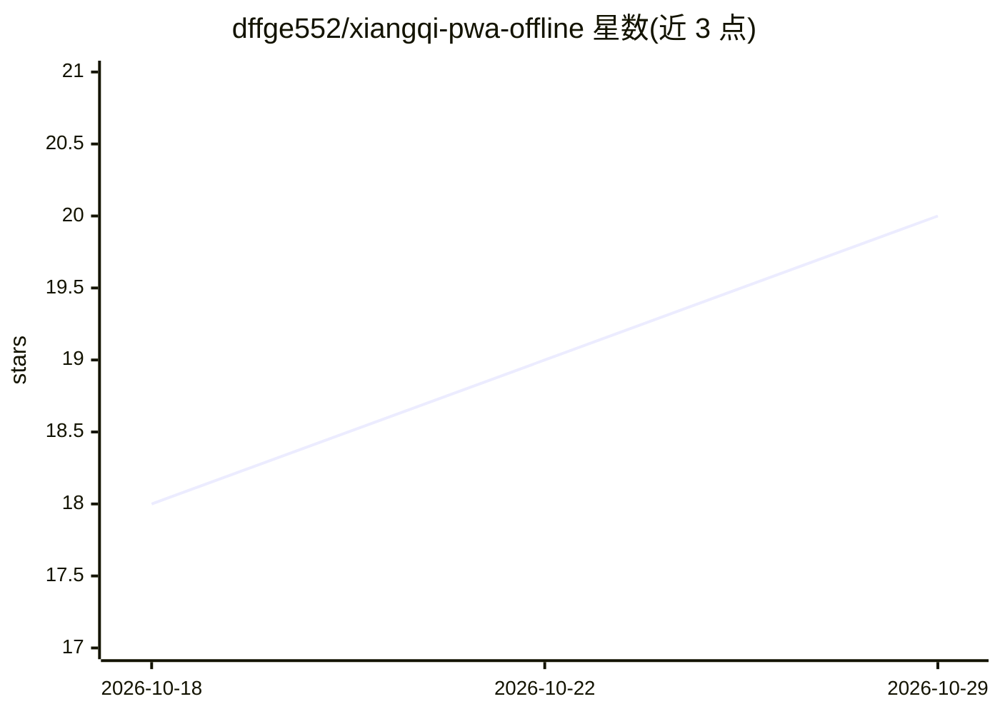

# dffge552/xiangqi-pwa-offline

⭐ 20 · HTML · MIT · 推送 2026-05-09 · [GitHub](https://github.com/dffge552/xiangqi-pwa-offline) · [官网](https://android-xiangqi-offline.netlify.app/) · 个人维护 · 中文 README

**离线可用的中国象棋 PWA 平台：AI 对弈、棋盘识别与题库**

基于原生 JavaScript 的中国象棋学习与对弈平台，以 PWA 形式提供完整离线功能。内置 Pikafish（WebAssembly）AI 引擎支持多难度对弈、实时着法建议与对局复盘；棋盘识别系统含在线截图与实体棋盘两种模式，使用三个自训 ONNX 模型做检测与分类；收录 7,300+ 道排局/残局题，并按 2024 版中规实现自动判负判和（困毙、长将、长捉等）。iOS 上 AI 对弈与分析因 WebAssembly 限制不可用。

## 筛选速览

| 维度 | 判定 | 备注 |
|---|---|---|
| AI 角色 | `ai-enhanced` | 去掉 AI 部分产品仍成立 |
| 许可风险 | `permissive` | MIT |
| 部署形态 | `None` |  |
| 模型依赖 | — | README 未给出锁定关系 |
| 硬件要求 | — | 无带数字的原话,不猜 |
| 安装摩擦 | `low` | 无编译、无系统依赖或容器化 |
| 成熟度 | — | 结构信号不足 |

## 能力要点

- Pikafish WebAssembly 引擎提供多难度 AI 对弈与复盘分析
- 双模式棋盘识别（实体棋盘透视校正 + 截图检测/分类，3 个 ONNX 模型）
- 7,300+ 题库覆盖布局、残局与战术局面
- 基于 2024 版中规的自动裁决：将死、困毙、重复局面、长将/长捉

## 适用场景

- 离线环境下与 AI 下象棋或双人对弈
- 拍照或截图识别实体/线上棋盘局面
- 通过题库与复盘分析练习棋艺

## 场景标签

`目标检测` · 领域:感知与多模态

## 证据(README 行号)

> L14: A comprehensive Xiangqi platform featuring AI gameplay, board recognition, and extensive puzzle libraries. Built wi
> L17: - 🤖 Local AI engine powered by Pikafish
> L18: - 📸 Open-source board recognition system (physical boards + screenshots)

## 星数曲线

2026-10-18 18 → 2026-10-29 20（+2）

---
*卡片 v1 · prompt 1.4 · 生成 2026-10-29 · 置信度 high · 依据 README sha `5d050c52e456` · [字段定义](../../DATASET.md)*
