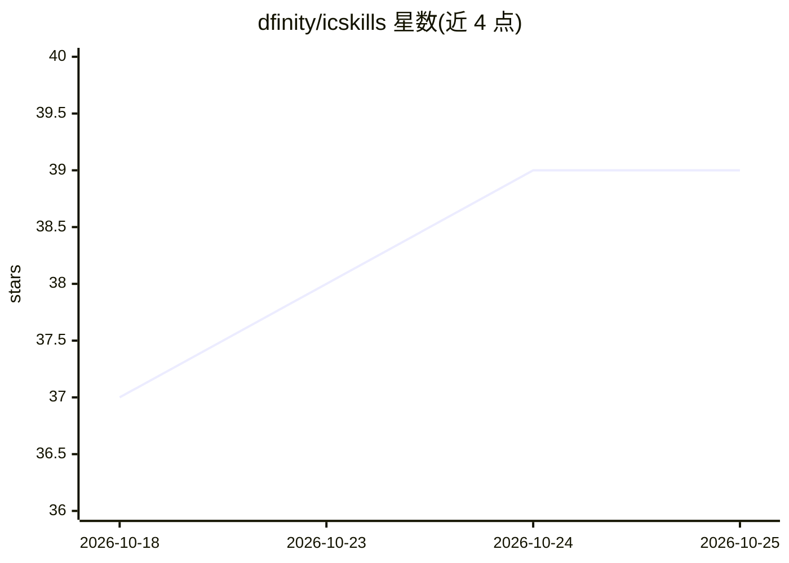

# dfinity/icskills

⭐ 39 · Python · Apache-2.0 · 推送 2026-10-23 · [GitHub](https://github.com/dfinity/icskills) · [官网](https://skills.internetcomputer.org) · 组织维护

**面向 AI agent 的 Internet Computer 开发技能文件集**

DFINITY 维护的 ICP 开发技能库：每个技能为一个含 YAML frontmatter 的自包含 SKILL.md，覆盖 ckbtc、Internet Identity、stable-memory 等能力，包含前置依赖版本、常见陷阱、可复制代码与部署测试命令，供 AI 编码 agent 读取以减少幻觉（虚构 canister ID、误用废弃 API）。提供 llms.txt 按需获取、npx skills CLI 安装、curl 手动获取及 .well-known 机器可读索引；带 sha256 内容 hash 的差异同步机制与 LLM-as-judge 评测脚本。声明处于活跃开发中，内容可能变动。

## 筛选速览

| 维度 | 判定 | 备注 |
|---|---|---|
| AI 角色 | `ai-knowledge` | 知识聚合/清单类 |
| 许可风险 | `permissive` | Apache-2.0 |
| 部署形态 | `desktop` | 安装包/桌面程序 |
| 模型依赖 | — | README 未给出锁定关系 |
| 硬件要求 | — | 无带数字的原话,不猜 |
| 安装摩擦 | `low` | 无编译、无系统依赖或容器化 |
| 成熟度 | `idea` | |

## 能力要点

- 技能文件含依赖版本、常见陷阱与经测试代码块
- 支持 llms.txt 按需获取 / npx CLI / curl 手动三种用法
- index.json 含 per-skill sha256 hash，支持差异同步
- 每技能可配评测文件，用 LLM judge 对比有无技能的 agent 输出

## 适用场景

- 让 AI 编码 agent 在 ICP 上构建时减少幻觉与陷阱
- 为 Claude Code / Cursor 等 agent 安装 ICP 领域技能
- 程序化发现与增量同步 ICP 技能文件

## 场景标签

`提示工程` · 领域:Agent 开发

## 证据(README 行号)

> L5: **Agent-readable instructions for every IC need.**
> L15: Each skill is a single markdown file containing everything an agent needs to build correctly:

## 星数曲线

2026-10-18 37 → 2026-10-25 39（+2）

---
*卡片 v1 · prompt 1.4 · 生成 2026-10-25 · 置信度 high · 依据 README sha `812303ef7550` · [字段定义](../../DATASET.md)*
