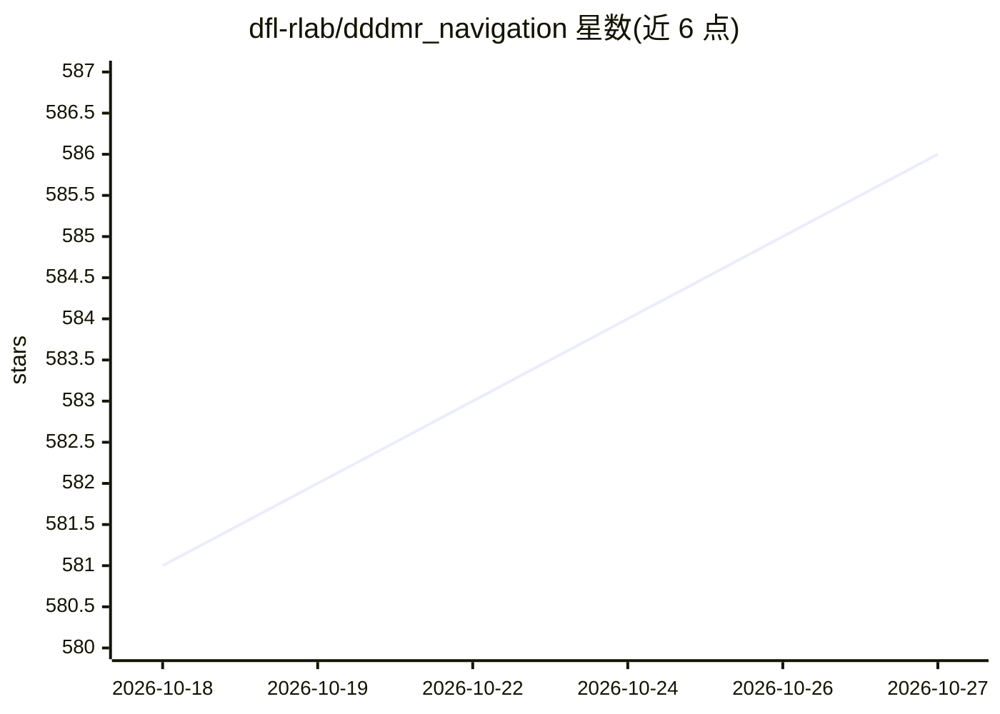

# dfl-rlab/dddmr_navigation

⭐ 586 · C++ · BSD-3-Clause · 推送 2026-10-26 · [GitHub](https://github.com/dfl-rlab/dddmr_navigation) · 组织维护

**面向移动机器人的 3D 导航栈：建图/定位/感知/规划/控制**

DDDMR Navigation 提供移动机器人与四足机器人（含 Unitree Go2 仿真）在三维环境中自主导航的完整软件栈：基于 LiDAR 的建图与地图精修、MCL 三维定位、三维感知（点云标记/清除）、全局与局部路径规划及 move_base 执行。设计目标是处理 Nav2 难以覆盖的多层楼面建图定位、坡道导航与立体结构规划等场景。各模块以独立 ROS 包形式提供并附文档；针对 16 线 LiDAR、Intel NUC/Jetson Orin Nano 等低成本硬件做过测试，并含多 LiDAR 安装角度的 CI/CD 测试套件。

## 筛选速览

| 维度 | 判定 | 备注 |
|---|---|---|
| AI 角色 | `ai-enhanced` | 去掉 AI 部分产品仍成立 |
| 许可风险 | `permissive` | BSD-3-Clause |
| 部署形态 | `None` |  |
| 模型依赖 | — | README 未给出锁定关系 |
| 硬件要求 | — | 无带数字的原话,不猜 |
| 安装摩擦 | `low` | 无编译、无系统依赖或容器化 |
| 成熟度 | — | 结构信号不足 |

## 能力要点

- 多层楼面建图与定位、坡道避障等三维导航能力
- 建图/定位/感知/全局规划/局部规划/move_base 分包提供并各有文档
- 多 LiDAR 安装角度（俯仰/横滚/偏航）的自动化 CI/CD 测试套件
- 在 16 线 LiDAR、Intel NUC/Jetson Orin Nano、消费级 IMU 等低成本硬件上测试

## 适用场景

- 让机器人在有坡道或多层结构的工厂/建筑环境中自主导航
- 为 Unitree Go2 等四足机器人做仿真导航测试
- 从 2D 导航栈迁移到 3D 导航的移动平台开发

## 场景标签

 · 领域:机器人/自主导航

## 证据(README 行号)

> L36: DDDMR navigation (3D Mobile Robot Navigation) is a navigation stack allows users to map, localize and autonomously 
> L28: > DDDMR Navigation Stack is designed to solve the issues that Nav2 not able to handle: such as multi-layer floor ma

## 星数曲线

2026-10-18 581 → 2026-10-27 586（+5）

---
*卡片 v1 · prompt 1.4 · 生成 2026-10-21 · 置信度 mid · 依据 README sha `8d47aa0fb500` · [字段定义](../../DATASET.md)*
